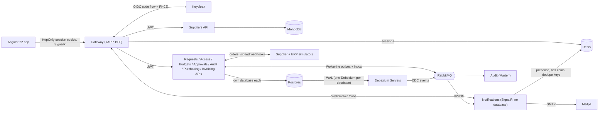
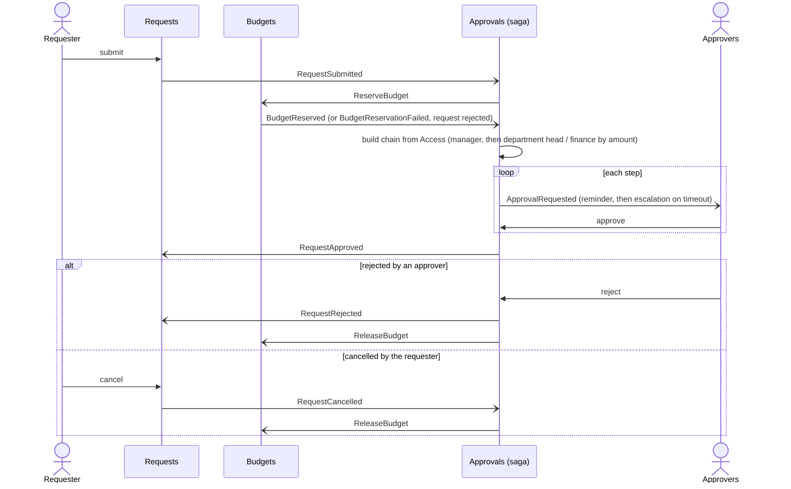
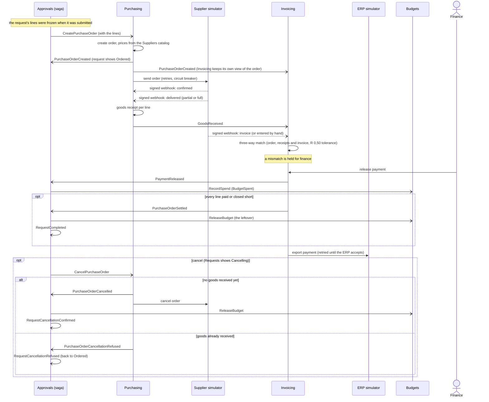

# ProcureAI

[](https://github.com/modefan/procure-ai/actions/workflows/ci.yml)

A multi-tenant procurement system in South African Rand (ZAR): employees raise purchase requests, a rules-driven
approval chain runs with budget reservation, approved requests become purchase orders sent to a supplier, deliveries are
received, and invoices are three-way matched and exported for payment. An AI policy assistant (RAG) and invoice
scanning come later. Built as a portfolio
demo of enterprise .NET and Angular practice: microservices, Clean Architecture, messaging, GitOps-style delivery.

**Status: plan 04 (Notifications and the Angular app) in final review.** What runs today: nine services (Requests, Access,
Budgets, Approvals, Audit, Suppliers, Purchasing, Invoicing, Notifications), two simulators (supplier and ERP), the BFF
gateway with Keycloak login, the Angular app, and per-database change data capture. A request is submitted, its budget
reserved, approved through a rules-driven chain, turned into a purchase order, delivered, invoiced, three-way matched and
paid (for example a R 86 940,00 order), with cancellation and rejection returning the budget, all audited end to end and
all visible in the app, which updates live as other people act. The AI assistant, invoice scanning and the admin screens
arrive in later plans.


## Architecture at a glance



Everything is orchestrated by .NET Aspire locally; logs, traces and metrics (OpenTelemetry) show in the Aspire dashboard.

## Services

| Service | Purpose | Data store |
|---|---|---|
| Requests | Purchase requests and their lines; draft, edit, submit, cancel | Postgres |
| Access | Role to permission matrix, cost-center approvers and approval limits, tenants | Postgres |
| Budgets | Cost-center budgets per fiscal year, reservations, release on reject or cancel | Postgres |
| Approvals | Approval chain, the approval saga, reminders and escalation, approver inbox | Postgres (saga state) |
| Audit | Business-event history, data-change audit matched to Debezium CDC | Marten (Postgres) |
| Suppliers | Supplier catalog and prices per tenant; read through its API by others, publishes no events | MongoDB |
| Purchasing | One purchase order per approved request, supplier delivery, goods receipt per line, cancellation | Postgres |
| Invoicing | Invoices (by webhook or entered), three-way match, payment export to the ERP | Postgres (invoice documents in `jsonb`) |
| Notifications | Live pushes (SignalR), presence ("Maria is viewing"), bell items and approval emails; **no database** | Redis |
| Simulators | Supplier and ERP stand-ins, deliberately slow and flaky | none |
| Gateway | YARP reverse proxy, BFF login, WebSocket proxy for the hub, Swagger UI with one definition per service | Redis (sessions) |

## The app

A client-side Angular 22 app (no SSR: every page after login is per user), Tailwind CSS with Angular Aria, NgRx
SignalStore for state, and API clients generated from each service's OpenAPI document. Money is Rand, shown the
South African way (`R 86 940,00`). What each role sees comes from permissions, not role names.

| Screen | Who | What it shows |
|---|---|---|
| Dashboard | everyone | tiles for what the user may see (approvals waiting, my open requests, budget used, invoices with a mismatch), recent activity, who is online |
| Requests, new request | requesters, managers, finance | list with filters; a form with a live budget check, the approvers preview and VAT |
| Request detail | everyone with `requests.read` | workflow timeline, audit trail, items, cancel, "Maria is also viewing" |
| Approvals | approvers | the inbox; approve or reject, with a conflict dialog when someone else got there first |
| Orders | requesters (their own), finance | orders with their supplier status, goods receipt per line, close short |
| Invoices and match | finance | three-way match per line, payment release, manual invoice entry |
| Budgets | requesters (their cost center), finance, admin | per cost center: budget, spent, reserved, available; edit with a floor check |

| Dashboard (live) | Request detail with presence |
|---|---|
|  |  |
| **Approvals inbox** | **Order and goods receipt** |
|  |  |
| **Three-way match** | **Budgets** |
|  |  |

### Live updates and presence

The page you are looking at changes when somebody else acts, with no reload and no polling.

- **Pushes carry IDs only.** When an event happens, Notifications sends `EntityChanged { entity, id, ... }` over
  SignalR to the tenant's group. The browser refetches through the normal, authorized APIs, so a push can never leak data
  the reader may not see. The hub is reached through the gateway (WebSockets, same cookie session), and the tenant comes
  from the token, never from the client.
- **Stores revalidate, they don't poll.** Each SignalStore shows what it has at once, refreshes in the background
  (stale-while-revalidate, 30 s by default, a whole session for reference data), shares identical in-flight requests,
  and refetches just the item a push names. Everything is cleared on logout.
- **Presence.** "Maria is also viewing" on a request and the avatars of who is online come from Redis with a 15 s
  heartbeat and a 45 s TTL, so a crashed browser tab drops off by itself. The header shows Live, Reconnecting or
  Offline; after a reconnect every store revalidates what it holds.
- **Conditional GETs.** Every GET carries an ETag and `Cache-Control: private, no-cache`; the browser revalidates with
  `If-None-Match` and gets a 304 when nothing changed. No Angular code involved, and the logout clears the browser cache
  (`Clear-Site-Data`) so the next user in the same tab sees none of it.
- **Writes wait for the server.** Approve, reject, pay and receive show a busy state and send `Idempotency-Key` and
  `If-Match`; a stale write gets a conflict dialog and the latest version.


## The approval flow



Each service that publishes events writes its state and those events in one transaction (Wolverine outbox), and Audit
records every event.

## From order to payment



Arrows to Approvals are the saga's input; "RequestCompleted" and the cancellation answers are events the saga publishes
for Requests and the audit trail.

## Run it locally

Prerequisites: Docker, .NET 10 SDK, Node 24.

1. Set the AppHost user secrets once (values are yours to choose; use long random strings):

   ```powershell
   $apphost = "src/AppHost/ProcureAi.AppHost"
   foreach ($name in "keycloak-admin-password", "keycloak-demo-password", "keycloak-gateway-secret", "keycloak-internal-secret", "keycloak-access-admin-secret", "debezium-password", "simulator-api-key", "supplier-webhook-secret") {
     dotnet user-secrets set "Parameters:$name" ([Convert]::ToHexString((1..24 | % { Get-Random -Max 256 }) -as [byte[]])) --project $apphost
   }
   # admin-api-key-sha256 is the SHA-256 (hex) of the one admin API key (X-Api-Key, for scripts and tests):
   $key = [Convert]::ToHexString((1..32 | % { Get-Random -Max 256 }) -as [byte[]])
   $sha = [Convert]::ToHexString([Security.Cryptography.SHA256]::HashData([Text.Encoding]::UTF8.GetBytes($key)))
   dotnet user-secrets set "Parameters:admin-api-key-sha256" $sha --project $apphost
   ```

   The end-to-end tests also read the key itself from the `DEMO_ADMIN_API_KEY` environment variable.
2. Start everything: `dotnet run --project src/AppHost/ProcureAi.AppHost`
3. Open the Aspire dashboard link printed in the console, then the `gateway` endpoint to use the app.

After pulling changes to a demo seed, reset the local data volumes once: the seed only adds rows that are missing, so an old
volume keeps old rows (for example the sandbox cost center DEMO-100 without its manager).

Memory and CPU caps for every container come from the `Resources` section of the AppHost `appsettings.json`.

**Resource needs (measured, idle after warm-up):** all containers together use about 3.4 GB (Keycloak 0.7 GB, six small Debezium Servers about 0.3 GB each, MongoDB 0.4 GB, Postgres 0.3 GB), and the nine services plus gateway, simulators and AppHost use about 3.8 GB of .NET working set (250 to 480 MB each). Add about 0.8 GB for the Angular dev server when developing. In total roughly 8 GB of RAM for the whole system, so a 16 GB VM has comfortable room.

## Demo users

Sign in through Keycloak; the demo password is the `keycloak-demo-password` parameter you set above.

| User | Tenant | Role |
|---|---|---|
| tom@acme.test | Acme | requester |
| maria@acme.test | Acme | manager |
| dept@acme.test | Acme | department-head |
| thandi@acme.test | Acme | finance |
| admin@acme.test | Acme | admin |
| ben@globex.test | Globex | manager |
| approver@demo.test | Demo | manager (approves requests on the sandbox cost center DEMO-100 of self-registered users) |

## Tests and CI

`dotnet test --project tests/<project>` per project (xUnit v3 on Microsoft.Testing.Platform). Unit, architecture
(layer rules), Testcontainers integration tests (Postgres, Redis, Keycloak, RabbitMQ), an Aspire AppHost test, and
Playwright end-to-end tests (live approval without reload, presence, conflict dialog, forbidden pages, logout isolation, reconnect), about 490 Vitest specs for the Angular app, plus a system test (`dotnet run --project tests/ProcureAi.SystemTests`) that starts the
whole AppHost and drives a request through approval, purchasing, invoicing and audit. GitHub Actions builds with warnings as errors and fails
the build if any of the services' OpenAPI documents (found by convention, so a new service is covered
automatically) or the generated Angular clients differ from what is committed. The test suites
are run locally before every push; their CI steps are switched off until the app is complete and will be re-enabled
before this repo goes public. CI generates random, per-run secrets; nothing sensitive is stored in the repo.

## Design decisions

- **BFF token handler at the gateway.** The browser only holds an HttpOnly, SameSite=Strict session cookie; tokens
  live server-side in Redis, with CSRF protection. Every service still validates the JWT itself.
- **Transactional outbox via Wolverine on Postgres.** State change and event commit together, so nothing is lost
  or published twice.
- **Idempotent writes and request coalescing.** POSTs need an `Idempotency-Key`; identical concurrent requests run
  once, across instances (FusionCache, Redis, distributed lock).
- **1-second micro-cache on every GET** absorbs bursts without visible staleness. One deliberate exception: Access's
  internal lookups for other services, which those services already cache per tenant generation (a micro-cached answer
  could outlive the `AccessChanged` event that revokes it).
- **Notifications has no database, on purpose.** Live pushes, presence and bell items are not business data, so
  Notifications listens to RabbitMQ with a plain consumer instead of the durable inbox (which would need Postgres). A
  duplicate message gives a duplicate push, and the client just refetches; emails are deduplicated by message ID in Redis.
  The cost: an email can be lost if the service dies between acknowledging a message and sending it. This is a deliberate
  exception to "every consumer uses the inbox"; everything that changes business state still does.
- **Two-layer data audit.** An EF Core interceptor records who changed what in the same transaction; Debezium reads
  the Postgres WAL so changes made outside the app are caught too.
- **Caller model: acting vs initiating.** Every handler knows who the action is *for* (the user) and who actually
  *performed* it (a user, a service, or the admin API key). Both reach the audit trail, so a service acting for a user
  or the admin key on behalf of a user is never mistaken for that user.
- **Client credentials between services.** Service-to-service calls use Keycloak client-credentials tokens, with the
  calling service and the user and tenant it acts for carried in headers; messages carry IDs, never tokens.
- **One Debezium Server per database.** Debezium Server reads one database per instance, so each captured database has
  its own small one. That keeps true database-per-service with no shared capture pipeline.
- **Interceptor rows matched against CDC.** An EF Core interceptor writes an audit row in the same transaction as each
  change; Audit matches every Debezium change to that row by transaction ID. A change with no matching row was made
  outside the app (manual SQL, a script) and is flagged.
- **Marten for audit.** Audit stores events and change records as documents in Postgres with Marten, where an
  append-only, query-by-request model fits better than relational tables.
- **Orchestrated saga in Approvals.** One saga per request drives budget reservation, the approval steps, reminders,
  escalation and compensation (budget release), with timeouts scheduled durably by Wolverine. The flow is in one place
  instead of spread across choreographed handlers.
- **Fiscal year in SAST.** A budget's fiscal year runs 1 March to the end of February in `Africa/Johannesburg` time, so a
  request submitted late on 28 February is judged by the South African calendar, not UTC.
- **Generated API client.** Angular calls are generated from each service's OpenAPI document (ng-openapi-gen, one client
  per service) and CI guards against drift of those clients and of the OpenAPI documents. The only hand-written HTTP is the
  BFF's own endpoints and the SignalR hub.
- **Event-carried order lines.** The request's lines are frozen when it is submitted and travel inside the saga's
  `CreatePurchaseOrder` command, so Purchasing builds the order without calling Requests back and keeps working when
  Requests is down.
- **The catalog is the price source.** Prices come from the Suppliers catalog, not from the requester, so a request
  cannot name its own price.
- **Purchasing decides cancellation.** Only Purchasing knows whether goods have arrived, so it alone accepts or refuses
  a cancel (allowed until the first receipt); the request shows Cancelling until its answer, then Cancelled (budget
  released) or back to Ordered.
- **Tombstones.** A cancel that overtakes the order's creation stores a cancelled placeholder order, so the create that
  follows does nothing; no race can resurrect a cancelled request.
- **Never-give-up supplier delivery with a circuit breaker.** A failed send (timeout, 5xx, open breaker) is recorded on
  the order and rescheduled with backoff until the supplier answers or the order is cancelled; the breaker stops
  hammering a down supplier. The order shows "Supplier unavailable, retrying" instead of failing.
  - *Known limit:* once the supplier has accepted the order, its confirmation arrives by webhook only. If that webhook is
    lost (the simulator gives up after its first try and 3 retries, about 36 s, for example while Purchasing restarts), the
    order stays "Sent to supplier": nothing polls the supplier or re-sends after a timeout. Nothing is stuck for good, because
    the requester can still cancel the request. A production system would re-send after a while (the supplier deduplicates
    by our order ID) or poll the supplier's order status.
- **Signed webhooks with a replay inbox.** Webhooks carry an HMAC-SHA256 signature over a timestamp and the body (5 minute
  tolerance, constant-time compare), and each event ID is stored in the same transaction as its effect, so forged,
  stale and replayed calls change nothing.
- **Cumulative three-way match.** Each invoice is matched against what was ordered and received minus what earlier
  invoices already claimed, so several invoices per order and partial deliveries work.
- **Payments at order price, with separation of duties.** Finance pays quantities at the order's price, never above it, and the
  requester of a request cannot release its payment (like approvals).
- **Spend per payment.** Budgets record spend for each payment (idempotent by payment ID), so
  partial payments and the leftover release give the same totals in either order.
- **MongoDB catalog with tenant collections.** Catalog data is documents and publishes no events, which suits MongoDB;
  one tenant-scoped collection wrapper makes the tenant filter impossible to forget.
- **Libraries that went commercial are avoided:** Wolverine instead of MassTransit v9, Mapperly instead of
  AutoMapper, plain handlers instead of MediatR, Shouldly instead of FluentAssertions, and YARP with ASP.NET Core's
  OIDC handlers instead of Duende BFF.
