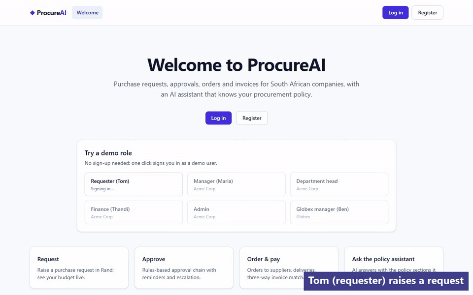
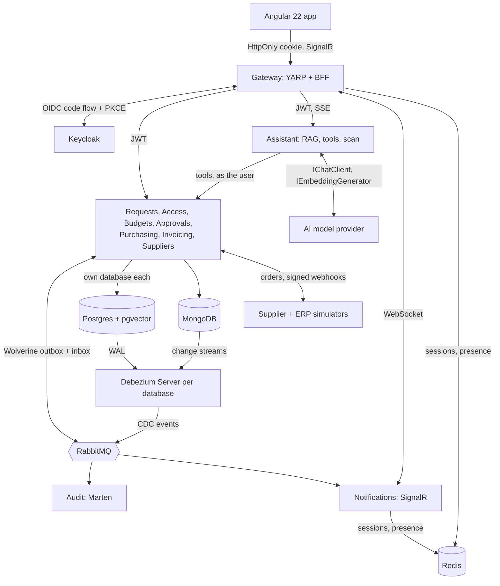
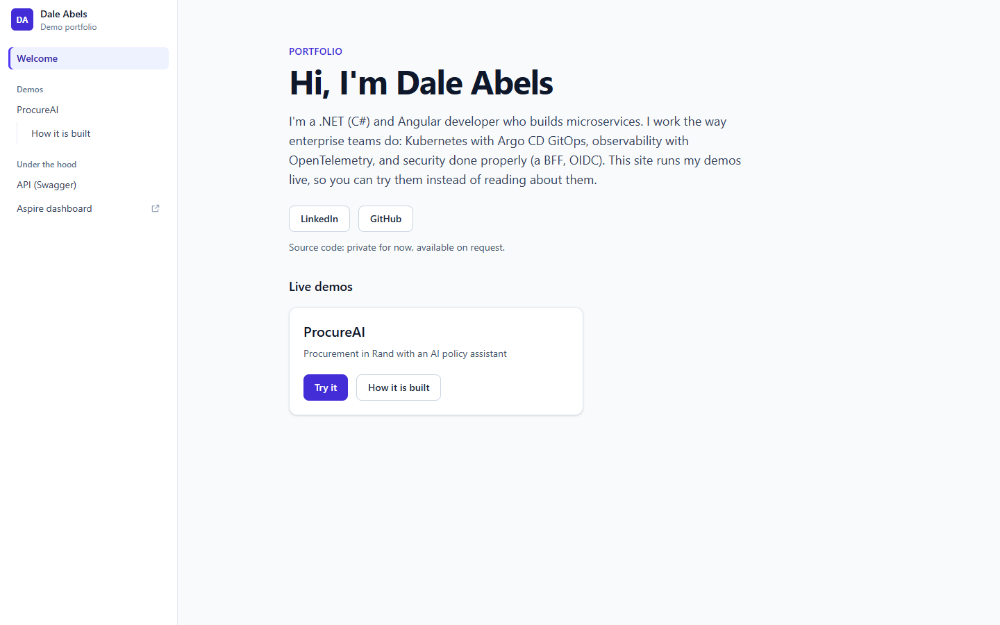
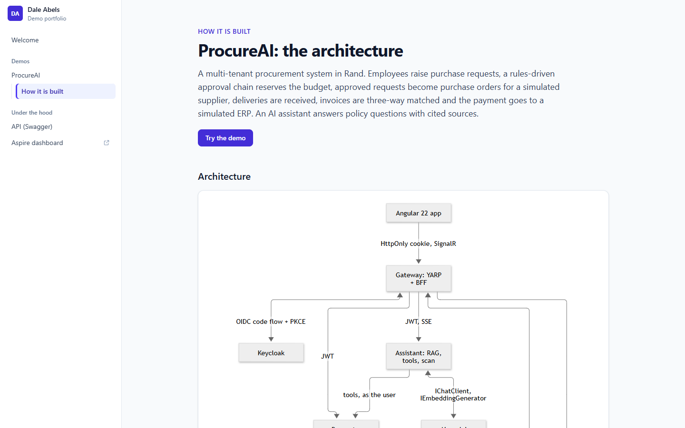
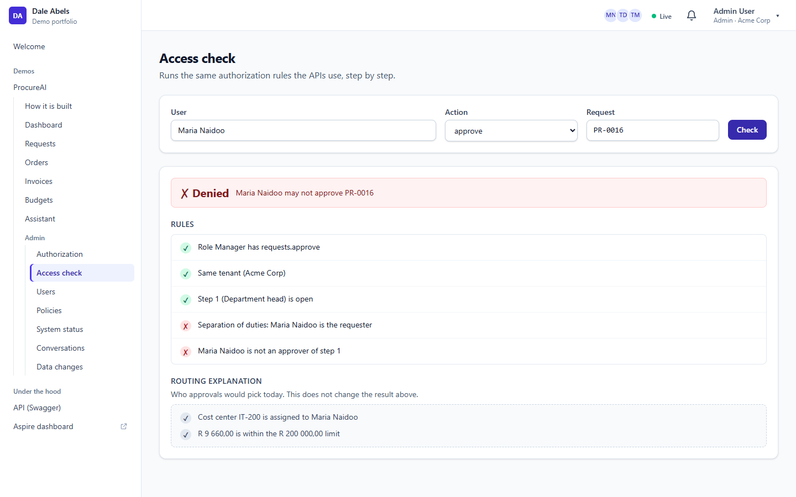
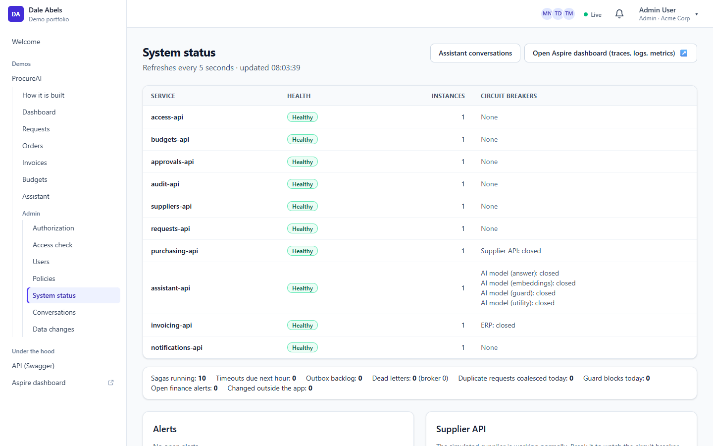
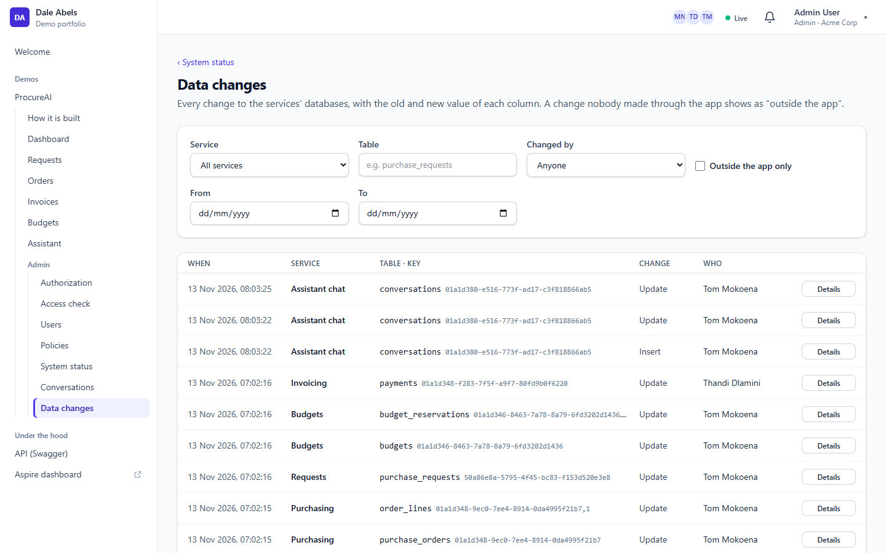
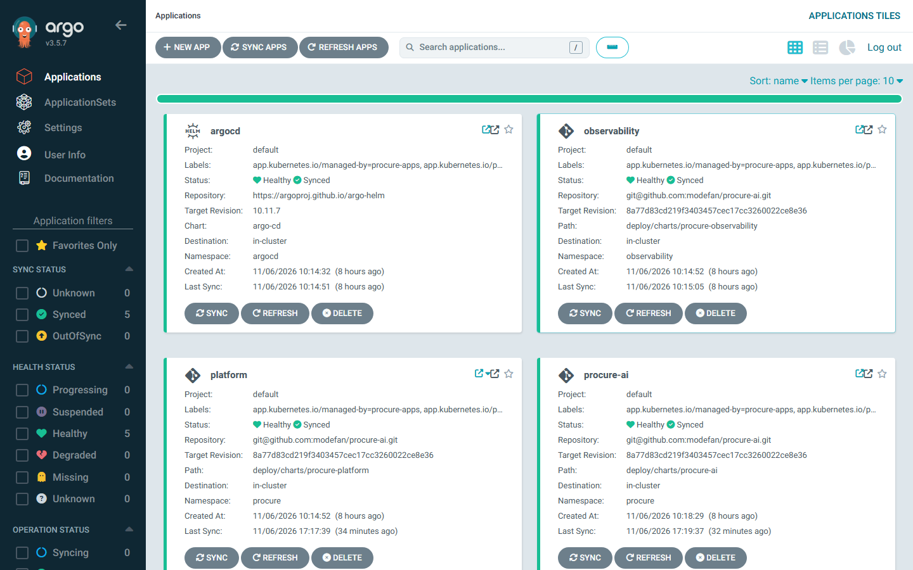

# ProcureAI

[](https://github.com/modefan/procure-ai/actions/workflows/ci.yml)

**A multi-tenant procurement system for South African companies, built to show enterprise .NET and Angular practice end to end.**
Employees raise purchase requests in Rand, a rules-driven approval chain reserves the budget and routes the request, approved
requests become purchase orders sent to a (simulated) supplier, deliveries are received, invoices are three-way matched and the
payment is exported to an ERP. An AI policy assistant answers questions with cited sources, and invoice PDFs are scanned into the
entry form. Under the hood: ten .NET 10 microservices in Clean Architecture, Wolverine sagas and outbox over RabbitMQ, a Keycloak
BFF at a YARP gateway, Debezium change data capture for a three-layer audit, an Angular 22 app with live updates, and a
Kubernetes deployment by Argo CD.

> **Live demo: <https://procure.daleabels.com>.** It also runs locally with [one command](#run-it-locally) or on a
> [local Kubernetes cluster](#run-it-on-kubernetes).

**No sign-up needed:** open the **Procurement demo** from the welcome page; its start page has **Try a demo role** buttons (on the live demo and locally) (Requester Tom, Manager Maria, Department head, Finance
Thandi, Admin, Globex manager Ben); one click signs you in as that person. Thandi works for two companies: through the normal
Keycloak login she gets Keycloak's organization picker between the email and the password, while her button starts straight in
Acme. All users and the seeded data: [docs/demo.md](docs/demo.md).



*The end-to-end test `Tom_requests_maria_approves_order_is_received_invoiced_and_paid`, recorded in three browsers (one per
person) and cut together: request to payment through the UI only, about 30 seconds.*

## What to look at

- **Microservices:** Database per service, events over RabbitMQ with Wolverine's transactional outbox and inbox, an orchestrated approval saga with timeouts, escalation and compensation ([Architecture and flows](docs/architecture.md)).
- **API patterns:** Idempotent POSTs with request coalescing across instances, a 1-second micro-cache on GETs, ETags and `If-Match`, circuit breakers on every outgoing call ([Design decisions](docs/design-decisions.md)).
- **Security:** BFF login (tokens never reach the browser), JWT validated in every service, permissions mapped from roles at runtime, resource rules such as separation of duties ([Admin screens](docs/admin.md)).
- **Audit:** Business events, an EF Core interceptor row per change, and Debezium reading the Postgres WAL and MongoDB change streams, so a change made outside the app is flagged ([Admin screens](docs/admin.md)).
- **AI:** RAG built by hand (hybrid pgvector + full-text search, citations), tools that act as the signed-in user, layered guardrails, invoice scanning ([The AI assistant](docs/assistant.md)).
- **Frontend:** Angular 22 with signals and NgRx SignalStore, Tailwind and Angular Aria, API clients generated from OpenAPI, SignalR live updates and presence ([Architecture and flows](docs/architecture.md#the-app)).
- **Delivery:** Helm charts, GitOps with Argo CD, images on GHCR, OpenTelemetry to an Aspire dashboard, migrations as sync hooks ([Kubernetes](docs/kubernetes.md)).

## Architecture



Every service has four projects (Domain, Application, Infrastructure, Api) with architecture tests that fail the build when a
layer rule is broken. The services, the approval saga and the order-to-payment flow as sequence diagrams:
[docs/architecture.md](docs/architecture.md).

## Screenshots

| Welcome: the portfolio start page | ProcureAI: how it is built |
|---|---|
|  |  |
| **Dashboard (live, who is online)** | **Request detail: workflow, "Maria Naidoo is also viewing"** |
|  |  |
| **Three-way match: why an invoice does not match** | **Policy assistant: a tool step, a quoted table, sources** |
|  |  |
| **Access check: separation of duties, rule by rule** | **System status: health, instances, circuit breakers** |
|  |  |
| **Data changes, captured by Debezium** | **Argo CD: the deployment, synced from Git** |
|  |  |

More screens (approvals inbox, orders, budgets, the authorization matrix, policy documents, invoice scan, the "behind the scenes"
panel) are in [docs/architecture.md](docs/architecture.md#the-app) and [docs/admin.md](docs/admin.md).

## Run it locally

Prerequisites: Docker, the .NET 10 SDK and Node 26 LTS. About 11 GiB of memory for the whole system under Aspire.

1. Set the AppHost user secrets once (generated random values; nothing secret is in the repo):

   ```powershell
   $apphost = "src/AppHost/ProcureAi.AppHost"
   foreach ($name in "keycloak-admin-password", "keycloak-demo-password", "keycloak-gateway-secret", "keycloak-internal-secret", "keycloak-access-admin-secret", "simulator-api-key", "supplier-webhook-secret") {
     dotnet user-secrets set "Parameters:$name" ([Convert]::ToHexString((1..24 | % { Get-Random -Max 256 }) -as [byte[]])) --project $apphost
   }
   # the one admin API key (X-Api-Key) for scripts and tests, and its SHA-256 for the services:
   $key = [Convert]::ToHexString((1..32 | % { Get-Random -Max 256 }) -as [byte[]])
   $sha = [Convert]::ToHexString([Security.Cryptography.SHA256]::HashData([Text.Encoding]::UTF8.GetBytes($key)))
   dotnet user-secrets set "Parameters:admin-api-key-sha256" $sha --project $apphost
   dotnet user-secrets set "Parameters:admin-api-key" $key --project $apphost
   ```

2. Start everything:

   ```powershell
   dotnet run --project src/AppHost/ProcureAi.AppHost
   ```

3. Open the Aspire dashboard link printed in the console, then the `gateway` endpoint. The demo data is seeded automatically
   (about two minutes on the first start).

The AI assistant runs on a built-in, keyless **demo model** until a real provider is configured; switching is configuration only
([docs/assistant.md](docs/assistant.md)). Resource caps, measured memory and resetting the data:
[docs/local-run.md](docs/local-run.md).

## Run it on Kubernetes

The same system runs on a single-node k3d cluster, deployed by **Argo CD** from the GitOps repo
[procure-ai-gitops](https://github.com/modefan/procure-ai-gitops): Helm charts in `deploy/charts/` here, environment values and the
deployed revision there, images on GitHub Container Registry. A push to `main` builds and publishes the images and commits the new
revision to the GitOps repo; Argo CD runs each service's migration Job before it rolls the pods. Bootstrap scripts create the
cluster, a local CA, the Secrets and Argo CD; then the app is at `https://procure.localtest.me`. It fits a 10 GiB node.
Everything else (architecture, bootstrap, hostnames, versions, memory, troubleshooting): [docs/kubernetes.md](docs/kubernetes.md).

## Design decisions

- **Wolverine, not MassTransit.** MassTransit v9 went commercial; Wolverine (MIT) gives messaging, sagas, durable scheduling and the
  transactional outbox and inbox on Postgres, so a state change and its events commit together.
- **Mapperly, not AutoMapper; Shouldly, not FluentAssertions; plain handlers, not MediatR.** All went commercial; Mapperly is
  source-generated, so a mapping mistake is a build error instead of a runtime surprise.
- **Our own idempotency filter.** `[Idempotent]` on a POST needs an `Idempotency-Key`: the first caller takes a Redis lock
  (DistributedLock) and runs, identical concurrent calls on any instance wait for the stored result (FusionCache + Redis), the same
  key with a different body gets 422. Small, tested, and nothing a third-party package hides.
- **BFF at the gateway with YARP, not Duende BFF.** The browser holds only an HttpOnly, `SameSite=Strict` session cookie; tokens
  stay server-side in Redis, with CSRF protection and server-side logout. Every service still validates the JWT itself.
  Keycloak stands in for Entra ID: switching is configuration only.
- **Debezium CDC and a three-layer audit.** Audit stores every business event; an EF Core interceptor writes who changed what in
  the same transaction; one Debezium Server per database reads the WAL (and MongoDB's change streams) and Audit matches each change
  to its interceptor row by transaction ID. A change with no match was made outside the app, and is flagged. pgaudit logs direct
  SQL by role.
- **RAG built by hand on Microsoft.Extensions.AI.** Chunking, contextual embeddings, hybrid search with rank fusion, the prompt and
  the citations are our own code over `IChatClient` and `IEmbeddingGenerator`, so every step is visible, tenant-filtered and
  tested. The provider is configuration; a deterministic fake keeps tests and CI from ever spending tokens.
- **Hosting: Kubernetes and GitOps on one small VM, Azure only for the AI model.** k3s and Argo CD on a single VM mirror an
  AKS + Argo CD setup for about USD 17 a month (the VM is EUR 14): no paid always-on cloud services beyond that one VM, and the AI
  model is paid per use, capped by a daily token limit per organisation (150 000 on the live demo, every model call counted) plus
  per-user limits (50 questions a day, 800 tokens per answer); the worst case under the caps is about USD 25 a month. The same charts would run on AKS. Scale-to-zero Azure Container Apps was the
  alternative; with ten services, eight Debezium Servers and Keycloak, one always-on VM is simpler and cheaper.

The full list (sagas, tombstones, signed webhooks, cumulative three-way matching, fiscal year in SAST, and more), each with its
reason: [docs/design-decisions.md](docs/design-decisions.md).

## Tests and CI

xUnit v3 unit and architecture tests, Testcontainers integration tests (Postgres, Redis, Keycloak, RabbitMQ), an Aspire AppHost
test, a system test that drives a request through every service, about 790 Vitest specs for the Angular app, and Playwright
end-to-end tests (the full flow above, live updates, presence, conflicts, forbidden pages, the assistant, the invoice scan, the
admin screens). CI builds with warnings as errors and fails when an OpenAPI document or a generated Angular client drifts from
what is committed.

**While the repo is private**, every Actions minute counts against the free 2 000 a month, so CI runs the build, drift checks,
unit, architecture and Vitest suites and the chart checks on every push, and the long suites weekly and on demand; the system and
Playwright tests run locally before each push until the repo is public. Details: [docs/testing.md](docs/testing.md).

## More documentation

[Architecture and flows](docs/architecture.md) · [The AI assistant](docs/assistant.md) ·
[Admin and system status](docs/admin.md) · [Demo users and data](docs/demo.md) · [Run it locally](docs/local-run.md) ·
[Kubernetes](docs/kubernetes.md) · [Tests and CI](docs/testing.md) · [Design decisions](docs/design-decisions.md) ·
[Adding a service](docs/service-template.md) · [Pre-generated Wolverine code](docs/generated-code.md) ·
[How the README images are made](docs/readme-assets.md)

## License

[MIT](LICENSE). Third-party packages keep their own licenses: MIT, Apache 2.0, BSD or similar, plus MPL-2.0 for one build-time
npm package (lightningcss, used by Tailwind) and one dual-licensed NuGet package (RabbitMQ.Client, Apache 2.0 or MPL-2.0). The MongoDB and Redis container images are under their own source-available licenses; they are pulled at run time,
not shipped in this repo.
