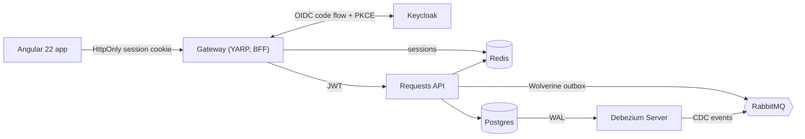

# ProcureAI

[](https://github.com/modefan/procure-ai/actions/workflows/ci.yml)

A multi-tenant procurement system in South African Rand (ZAR): employees raise purchase requests, a rules-driven
approval chain runs with budget reservation, approved requests become purchase orders, and invoices are three-way
matched and exported for payment. An AI policy assistant (RAG) and invoice scanning come later. Built as a portfolio
demo of enterprise .NET and Angular practice: microservices, Clean Architecture, messaging, GitOps-style delivery.

**Status: walking skeleton (plan 01 of 8).** What runs today: the Requests service end to end (create, list, submit),
the BFF gateway with Keycloak login, the Angular app, audit and CDC plumbing, and the CI pipeline. Approvals, budgets,
purchasing, invoicing and the AI assistant arrive in the following plans.

## Architecture at a glance



Everything is orchestrated by .NET Aspire locally; logs, traces and metrics (OpenTelemetry) show in the Aspire dashboard.

## Run it locally

Prerequisites: Docker, .NET 10 SDK, Node 24.

1. Set the AppHost user secrets once (values are yours to choose; use long random strings):

   ```powershell
   $apphost = "src/AppHost/ProcureAi.AppHost"
   foreach ($name in "keycloak-admin-password", "keycloak-demo-password", "keycloak-gateway-secret", "keycloak-internal-secret", "debezium-password") {
     dotnet user-secrets set "Parameters:$name" ([Convert]::ToHexString((1..24 | % { Get-Random -Max 256 }) -as [byte[]])) --project $apphost
   }
   # admin-api-key-sha256 is the SHA-256 (hex) of the one admin API key (X-Api-Key, for scripts and tests):
   $key = [Convert]::ToHexString((1..32 | % { Get-Random -Max 256 }) -as [byte[]])
   $sha = [Convert]::ToHexString([Security.Cryptography.SHA256]::HashData([Text.Encoding]::UTF8.GetBytes($key)))
   dotnet user-secrets set "Parameters:admin-api-key-sha256" $sha --project $apphost
   ```

   The end-to-end tests also read the key itself from the `DEMO_ADMIN_API_KEY` environment variable.
2. Start everything: `dotnet run --project src/AppHost/ProcureAi.AppHost`
3. Open the Aspire dashboard link printed in the console, then the `gateway` endpoint to use the app.

Memory and CPU caps for every container come from the `Resources` section of the AppHost `appsettings.json`.

## Demo users

Sign in through Keycloak; the demo password is the `keycloak-demo-password` parameter you set above.

| User | Tenant | Role |
|---|---|---|
| tom@acme.test | Acme | requester |
| maria@acme.test | Acme | manager |
| dept@acme.test | Acme | department-head |
| thandi@acme.test | Acme | finance |
| admin@acme.test | Acme | admin |
| ben@globex.test | Globex | manager |

## Tests and CI

`dotnet test --project tests/<project>` per project (xUnit v3 on Microsoft.Testing.Platform). Unit, architecture
(layer rules), Testcontainers integration tests (Postgres, Redis, Keycloak, RabbitMQ), an Aspire AppHost test, and
Playwright end-to-end tests. GitHub Actions builds with warnings as errors, runs every suite, fails the build if the
generated Angular API client drifts from the OpenAPI documents, and runs the end-to-end suite. CI generates random,
per-run secrets; nothing sensitive is stored in the repo.

## Design decisions

- **BFF token handler at the gateway.** The browser only holds an HttpOnly, SameSite=Strict session cookie; tokens
  live server-side in Redis, with CSRF protection. Every service still validates the JWT itself.
- **Transactional outbox via Wolverine on Postgres.** State change and event commit together, so nothing is lost
  or published twice.
- **Idempotent writes and request coalescing.** POSTs need an `Idempotency-Key`; identical concurrent requests run
  once, across instances (FusionCache, Redis, distributed lock).
- **1-second micro-cache on every GET** absorbs bursts without visible staleness.
- **Two-layer data audit.** An EF Core interceptor records who changed what in the same transaction; Debezium reads
  the Postgres WAL so changes made outside the app are caught too.
- **Generated API client.** Angular calls are generated from each service's OpenAPI document (ng-openapi-gen) and CI
  guards against drift.
- **Libraries that went commercial are avoided:** Wolverine instead of MassTransit v9, Mapperly instead of
  AutoMapper, plain handlers instead of MediatR, Shouldly instead of FluentAssertions, and YARP with ASP.NET Core's
  OIDC handlers instead of Duende BFF.
