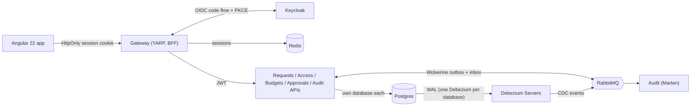
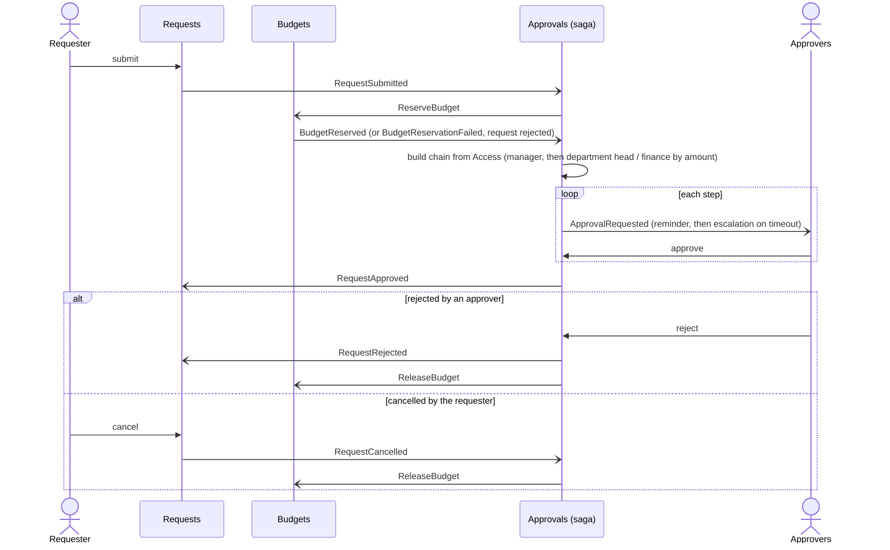

# ProcureAI

[](https://github.com/modefan/procure-ai/actions/workflows/ci.yml)

A multi-tenant procurement system in South African Rand (ZAR): employees raise purchase requests, a rules-driven
approval chain runs with budget reservation, approved requests become purchase orders, and invoices are three-way
matched and exported for payment. An AI policy assistant (RAG) and invoice scanning come later. Built as a portfolio
demo of enterprise .NET and Angular practice: microservices, Clean Architecture, messaging, GitOps-style delivery.

**Status: plan 02 of 8 done (final review in progress).** What runs today: five services (Requests, Access, Budgets, Approvals, Audit), the BFF
gateway with Keycloak login, the Angular app, and per-database change data capture. A purchase request can be
submitted, its budget reserved, approved through a rules-driven chain (or rejected or cancelled, which returns the
budget) and audited end to end. Purchasing, invoicing and the AI assistant arrive in the following plans.

## Architecture at a glance



Everything is orchestrated by .NET Aspire locally; logs, traces and metrics (OpenTelemetry) show in the Aspire dashboard.

## Services

| Service | Purpose | Data store |
|---|---|---|
| Requests | Purchase requests and their lines; draft, edit, submit, cancel | Postgres |
| Access | Role to permission matrix, cost-center approvers and approval limits, tenants | Postgres |
| Budgets | Cost-center budgets per fiscal year, reservations, release on reject or cancel | Postgres |
| Approvals | Approval chain, the approval saga, reminders and escalation, approver inbox | Postgres (saga state) |
| Audit | Business-event history, data-change audit matched to Debezium CDC | Marten (Postgres) |
| Gateway | YARP reverse proxy, BFF login, Swagger UI with one definition per service | Redis (sessions) |

## The approval flow



Each service that publishes events writes its state and those events in one transaction (Wolverine outbox), and Audit
records every event.

## Run it locally

Prerequisites: Docker, .NET 10 SDK, Node 24.

1. Set the AppHost user secrets once (values are yours to choose; use long random strings):

   ```powershell
   $apphost = "src/AppHost/ProcureAi.AppHost"
   foreach ($name in "keycloak-admin-password", "keycloak-demo-password", "keycloak-gateway-secret", "keycloak-internal-secret", "keycloak-access-admin-secret", "debezium-password") {
     dotnet user-secrets set "Parameters:$name" ([Convert]::ToHexString((1..24 | % { Get-Random -Max 256 }) -as [byte[]])) --project $apphost
   }
   # admin-api-key-sha256 is the SHA-256 (hex) of the one admin API key (X-Api-Key, for scripts and tests):
   $key = [Convert]::ToHexString((1..32 | % { Get-Random -Max 256 }) -as [byte[]])
   $sha = [Convert]::ToHexString([Security.Cryptography.SHA256]::HashData([Text.Encoding]::UTF8.GetBytes($key)))
   dotnet user-secrets set "Parameters:admin-api-key-sha256" $sha --project $apphost
   ```

   The end-to-end tests also read the key itself from the `DEMO_ADMIN_API_KEY` environment variable.
2. Start everything: `dotnet run --project src/AppHost/ProcureAi.AppHost`
3. Open the Aspire dashboard link printed in the console, then the `gateway` endpoint to use the app.

Memory and CPU caps for every container come from the `Resources` section of the AppHost `appsettings.json`.

## Demo users

Sign in through Keycloak; the demo password is the `keycloak-demo-password` parameter you set above.

| User | Tenant | Role |
|---|---|---|
| tom@acme.test | Acme | requester |
| maria@acme.test | Acme | manager |
| dept@acme.test | Acme | department-head |
| thandi@acme.test | Acme | finance |
| admin@acme.test | Acme | admin |
| ben@globex.test | Globex | manager |
| approver@demo.test | Demo | manager (approves requests on the sandbox cost center DEMO-100 of self-registered users) |

## Tests and CI

`dotnet test --project tests/<project>` per project (xUnit v3 on Microsoft.Testing.Platform). Unit, architecture
(layer rules), Testcontainers integration tests (Postgres, Redis, Keycloak, RabbitMQ), an Aspire AppHost test, and
Playwright end-to-end tests, plus a system test (`dotnet run --project tests/ProcureAi.SystemTests`) that starts the
whole AppHost and drives a request through approval and audit. GitHub Actions builds with warnings as errors and fails
the build if the generated Angular API client drifts from any of the five services' OpenAPI documents. The test suites
are run locally before every push; their CI steps are switched off until the app is complete and will be re-enabled
before this repo goes public. CI generates random, per-run secrets; nothing sensitive is stored in the repo.

## Design decisions

- **BFF token handler at the gateway.** The browser only holds an HttpOnly, SameSite=Strict session cookie; tokens
  live server-side in Redis, with CSRF protection. Every service still validates the JWT itself.
- **Transactional outbox via Wolverine on Postgres.** State change and event commit together, so nothing is lost
  or published twice.
- **Idempotent writes and request coalescing.** POSTs need an `Idempotency-Key`; identical concurrent requests run
  once, across instances (FusionCache, Redis, distributed lock).
- **1-second micro-cache on every GET** absorbs bursts without visible staleness. One deliberate exception: Access's
  internal lookups for other services, which those services already cache per tenant generation (a micro-cached answer
  could outlive the `AccessChanged` event that revokes it).
- **Two-layer data audit.** An EF Core interceptor records who changed what in the same transaction; Debezium reads
  the Postgres WAL so changes made outside the app are caught too.
- **Caller model: acting vs initiating.** Every handler knows who the action is *for* (the user) and who actually
  *performed* it (a user, a service, or the admin API key). Both reach the audit trail, so a service acting for a user
  or the admin key on behalf of a user is never mistaken for that user.
- **Client credentials between services.** Service-to-service calls use Keycloak client-credentials tokens, with the
  calling service and the user and tenant it acts for carried in headers; messages carry IDs, never tokens.
- **One Debezium Server per database.** Debezium Server reads one database per instance, so each captured database has
  its own small one. That keeps true database-per-service with no shared capture pipeline.
- **Interceptor rows matched against CDC.** An EF Core interceptor writes an audit row in the same transaction as each
  change; Audit matches every Debezium change to that row by transaction ID. A change with no matching row was made
  outside the app (manual SQL, a script) and is flagged.
- **Marten for audit.** Audit stores events and change records as documents in Postgres with Marten, where an
  append-only, query-by-request model fits better than relational tables.
- **Orchestrated saga in Approvals.** One saga per request drives budget reservation, the approval steps, reminders,
  escalation and compensation (budget release), with timeouts scheduled durably by Wolverine. The flow is in one place
  instead of spread across choreographed handlers.
- **Fiscal year in SAST.** A budget's fiscal year runs 1 March to the end of February in `Africa/Johannesburg` time, so a
  request submitted late on 28 February is judged by the South African calendar, not UTC.
- **Generated API client.** Angular calls are generated from the OpenAPI document (ng-openapi-gen; the Requests client so
  far) and CI guards against drift for all five services' documents.
- **Libraries that went commercial are avoided:** Wolverine instead of MassTransit v9, Mapperly instead of
  AutoMapper, plain handlers instead of MediatR, Shouldly instead of FluentAssertions, and YARP with ASP.NET Core's
  OIDC handlers instead of Duende BFF.
