# ProcureAI

[](https://github.com/modefan/procure-ai/actions/workflows/ci.yml)

A multi-tenant procurement system in South African Rand (ZAR): employees raise purchase requests, a rules-driven
approval chain runs with budget reservation, approved requests become purchase orders sent to a supplier, deliveries are
received, and invoices are three-way matched and exported for payment. An AI policy assistant (RAG over the policy and
past purchases, with cited sources and read-only tools) answers questions, and invoice PDFs are scanned into the entry form.
Built as a portfolio demo of enterprise .NET and Angular practice: microservices, Clean Architecture, messaging, GitOps-style
delivery.

**Status: plan 06 (admin screens, system status, demo polish) complete; the deployment comes next.** What runs today: ten services (Requests, Access, Budgets,
Approvals, Audit, Suppliers, Purchasing, Invoicing, Notifications, Assistant), two simulators (supplier and ERP), the BFF
gateway with Keycloak login, the Angular app, and per-database change data capture. A request is submitted, its budget
reserved, approved through a rules-driven chain, turned into a purchase order, delivered, invoiced, three-way matched and
paid (for example a R 86 940,00 order), with cancellation and rejection returning the budget, all audited end to end and
all visible in the app, which updates live as other people act. The assistant answers policy questions with sources and
looks things up as the user; invoice PDFs are scanned and checked before anyone saves them. **No real AI model is connected
yet:** the assistant runs on a built-in, keyless demo model (see [The AI assistant](#the-ai-assistant)). The admin
screens (authorization matrix, users and limits, access check, system status with a chaos switch, data changes), a "behind the scenes"
panel, one-click demo roles, seed data in every state and a nightly reset are in; the deployment comes in a later plan.

## Architecture at a glance

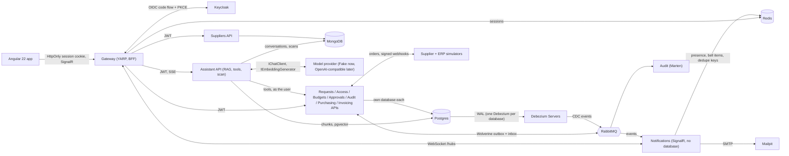

Everything is orchestrated by .NET Aspire locally; logs, traces and metrics (OpenTelemetry) show in the Aspire dashboard.

## Services

| Service | Purpose | Data store |
|---|---|---|
| Requests | Purchase requests and their lines; draft, edit, submit, cancel | Postgres |
| Access | Role to permission matrix, cost-center approvers and approval limits, tenants | Postgres |
| Budgets | Cost-center budgets per fiscal year, reservations, release on reject or cancel | Postgres |
| Approvals | Approval chain, the approval saga, reminders and escalation, approver inbox | Postgres (saga state) |
| Audit | Business-event history, data-change audit matched to Debezium CDC | Marten (Postgres) |
| Suppliers | Supplier catalog and prices per tenant; read through its API by others, publishes no events | MongoDB |
| Purchasing | One purchase order per approved request, supplier delivery, goods receipt per line, cancellation | Postgres |
| Invoicing | Invoices (by webhook or entered), three-way match, payment export to the ERP | Postgres (invoice documents in `jsonb`) |
| Notifications | Live pushes (SignalR), presence ("Maria is viewing"), bell items and approval emails; **no database** | Redis |
| Assistant | Policy assistant (RAG over policy documents and past purchases, six read-only tools), policy document ingestion, invoice scanning | Postgres + pgvector, MongoDB (conversations, scans) |
| Simulators | Supplier and ERP stand-ins, deliberately slow and flaky | none |
| Gateway | YARP reverse proxy, BFF login, WebSocket proxy for the hub, Swagger UI with one definition per service | Redis (sessions) |

## The app

A client-side Angular 22 app (no SSR: every page after login is per user), Tailwind CSS with Angular Aria, NgRx
SignalStore for state, and API clients generated from each service's OpenAPI document. Money is Rand, shown the
South African way (`R 86 940,00`). What each role sees comes from permissions, not role names.

| Screen | Who | What it shows |
|---|---|---|
| Dashboard | everyone | tiles for what the user may see (approvals waiting, my open requests, budget used, invoices with a mismatch), recent activity, who is online |
| Requests, new request | requesters, managers, finance | list with filters; a form with a live budget check, the approvers preview and VAT |
| Request detail | everyone with `requests.read` | workflow timeline, audit trail, items, cancel, "Maria is also viewing" |
| Approvals | approvers | the inbox; approve or reject, with a conflict dialog when someone else got there first |
| Orders | requesters (their own), finance | orders with their supplier status, goods receipt per line, close short |
| Invoices and match | finance | three-way match per line, payment release, manual invoice entry |
| Budgets | requesters (their cost center), finance, admin | per cost center: budget, spent, reserved, available; edit with a floor check |
| Assistant | everyone with `assistant.use` | conversations; the answer streams with its sources, the tools it used and Markdown tables; Stop, regenerate, edit |
| Policy documents | admins | upload, replace and remove the documents the assistant answers from, with live ingestion progress |
| Invoice scan | everyone with `invoices.create` | drop a PDF on the invoices screen; the scan prefills the entry form, the order it names is chosen |
| Admin screens | admins | see [Admin, system status and behind the scenes](#admin-system-status-and-behind-the-scenes) |

| Dashboard (live) | Request detail with presence |
|---|---|
| 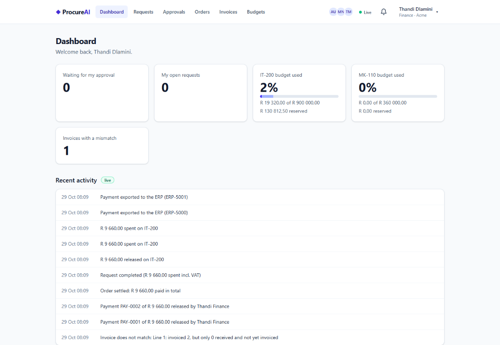 | 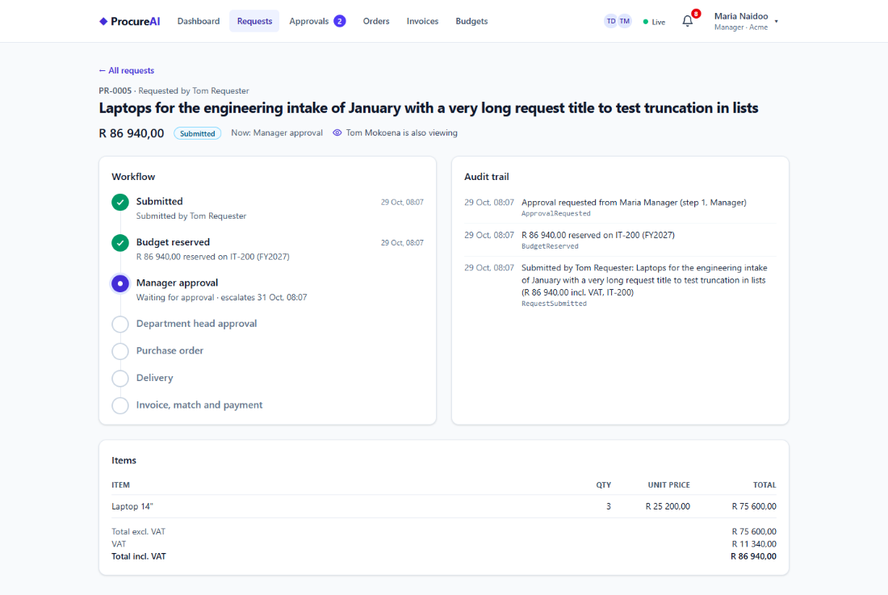 |
| **Approvals inbox** | **Order and goods receipt** |
| 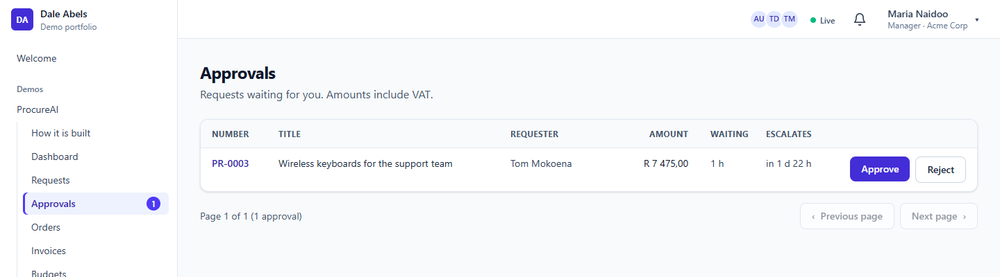 | 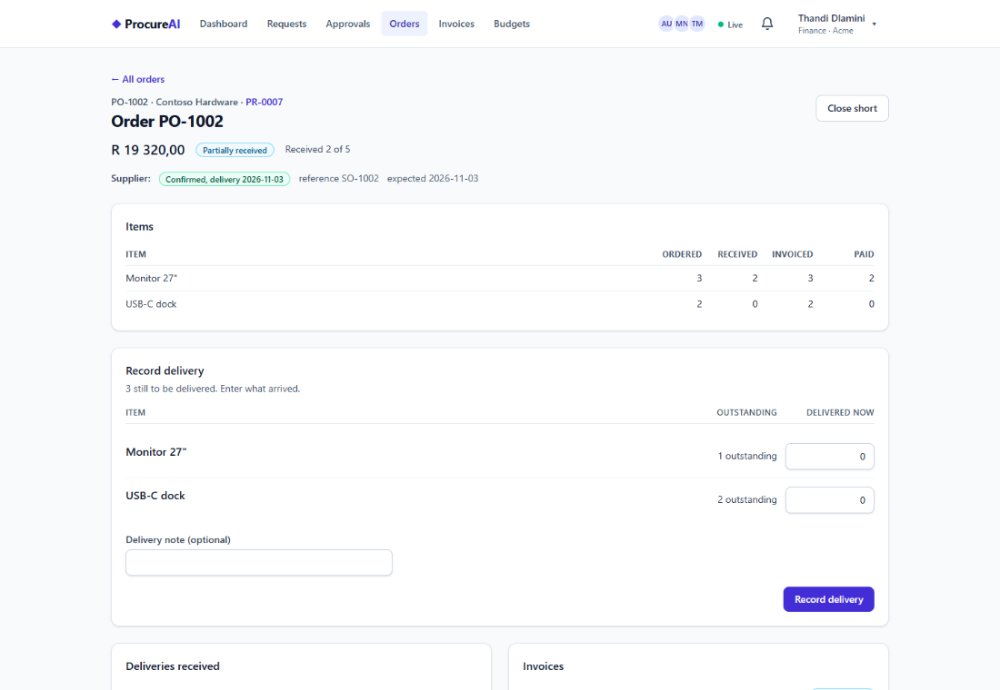 |
| **Three-way match** | **Budgets** |
| 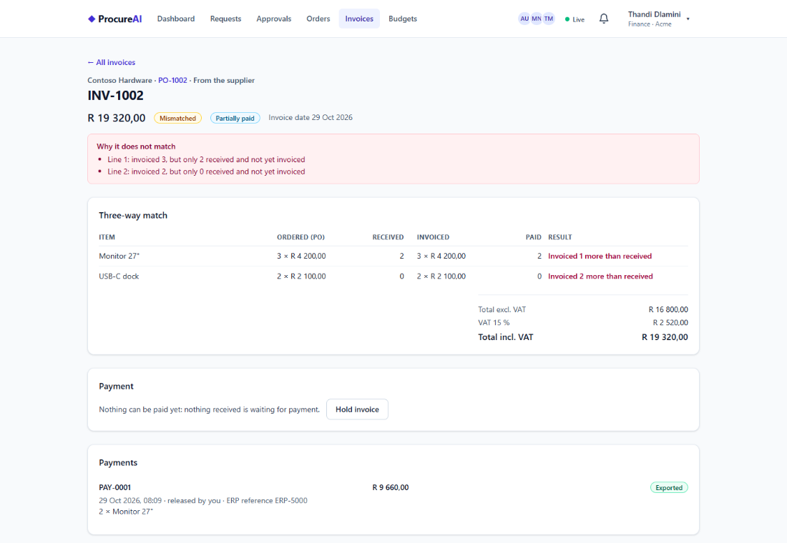 | 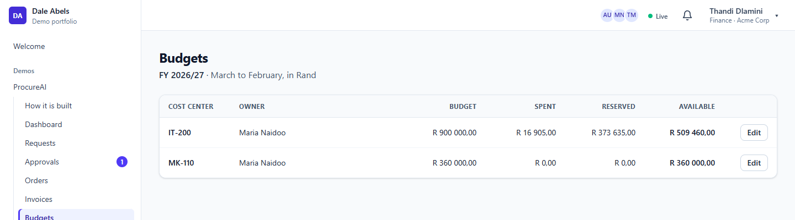 |
| **Assistant: sources, a tool step and a quoted table** | **Policy documents** |
| 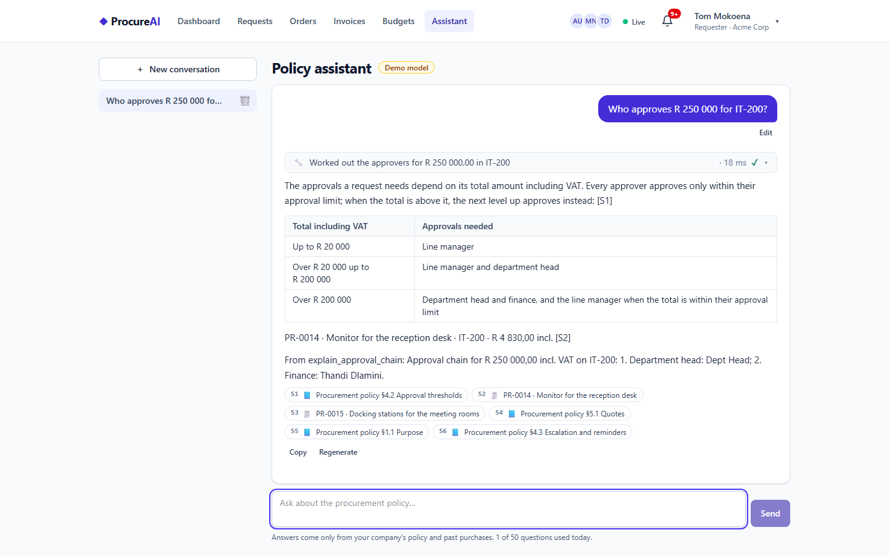 | 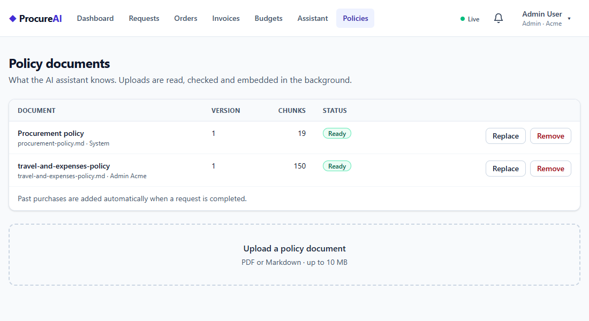 |
| **Invoice scan, prefilled for review** | |
| 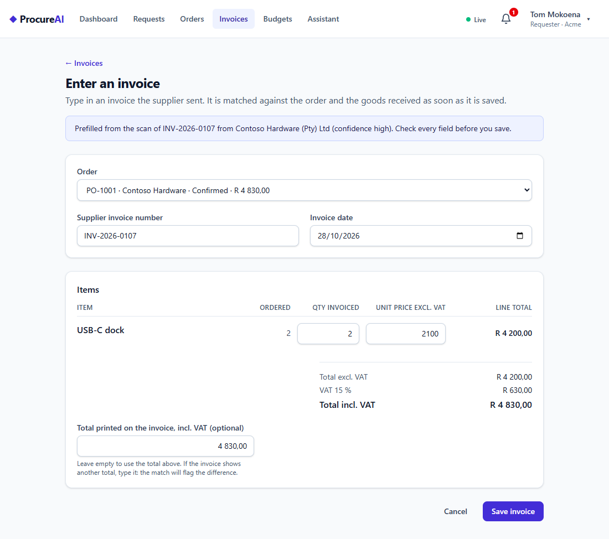 | |

### Live updates and presence

The page you are looking at changes when somebody else acts, with no reload and no polling.

- **Pushes carry IDs only.** When an event happens, Notifications sends `EntityChanged { entity, id, ... }` over
  SignalR to the tenant's group. The browser refetches through the normal, authorized APIs, so a push can never leak data
  the reader may not see. The hub is reached through the gateway (WebSockets, same cookie session), and the tenant comes
  from the token, never from the client.
- **Stores revalidate, they don't poll.** Each SignalStore shows what it has at once, refreshes in the background
  (stale-while-revalidate, 30 s by default, a whole session for reference data), shares identical in-flight requests,
  and refetches just the item a push names. Everything is cleared on logout.
- **Presence.** "Maria is also viewing" on a request and the avatars of who is online come from Redis with a 15 s
  heartbeat and a 45 s TTL, so a crashed browser tab drops off by itself. The header shows Live, Reconnecting or
  Offline; after a reconnect every store revalidates what it holds.
- **Conditional GETs.** Every GET carries an ETag and `Cache-Control: private, no-cache`; the browser revalidates with
  `If-None-Match` and gets a 304 when nothing changed. No Angular code involved, and the logout clears the browser cache
  (`Clear-Site-Data`) so the next user in the same tab sees none of it.
- **Writes wait for the server.** Approve, reject, pay and receive show a busy state and send `Idempotency-Key` and
  `If-Match`; a stale write gets a conflict dialog and the latest version.

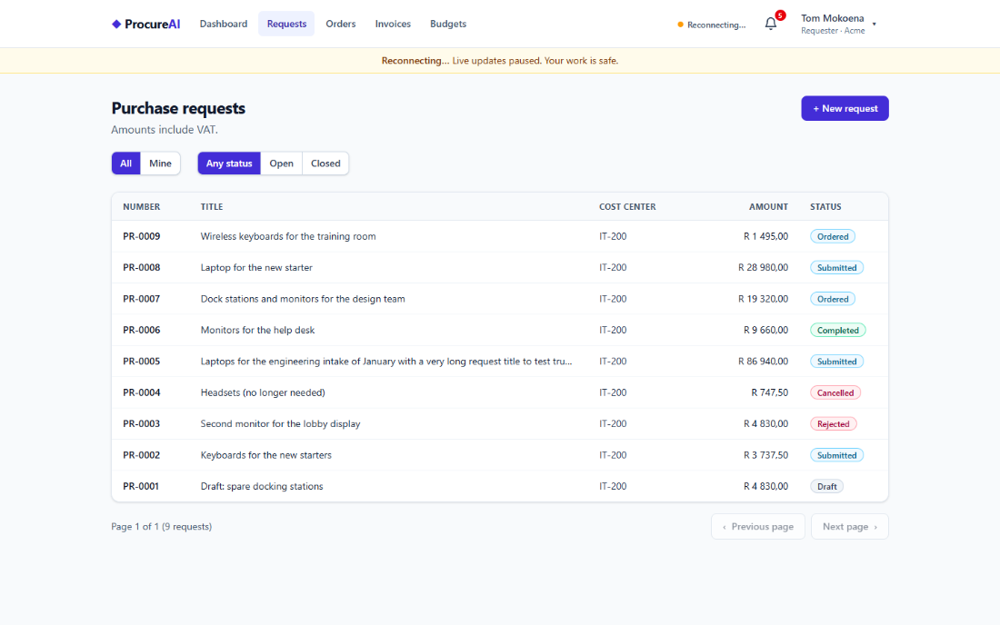

## The approval flow

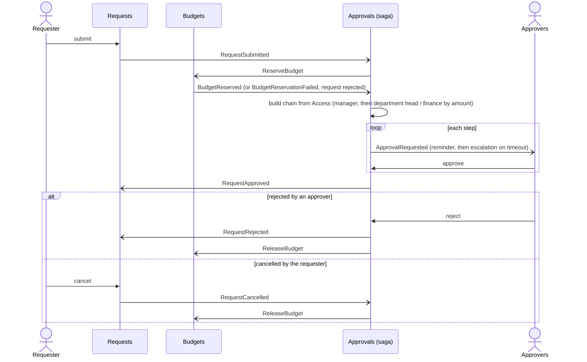

Each service that publishes events writes its state and those events in one transaction (Wolverine outbox), and Audit
records every event.

## From order to payment

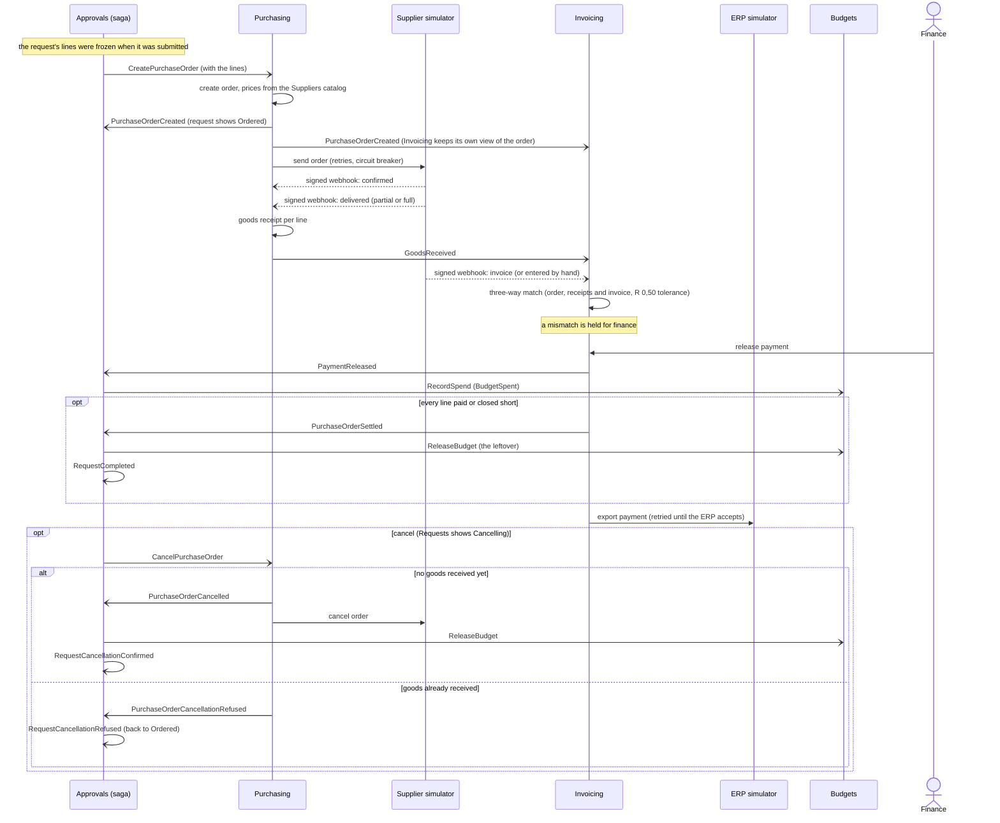

Arrows to Approvals are the saga's input; "RequestCompleted" and the cancellation answers are events the saga publishes
for Requests and the audit trail.

## The AI assistant

The Assistant service answers questions about the procurement policy and the company's past purchases, cites where every
fact comes from, and can look things up (a request's status, who must approve an amount, a budget) **as the person asking**.
It also reads supplier invoices from PDF. All AI calls go through Microsoft.Extensions.AI (`IChatClient`,
`IEmbeddingGenerator`); no provider SDK type is used outside one setup class, and an architecture test keeps it that way.

> **Which model answers today: a built-in demo model.** The plan was GitHub Models for development (free), but GitHub
> retired it on 2026-07-30. A real provider (Azure AI Foundry or any OpenAI-compatible endpoint) needs a cloud account,
> which is the owner's call and has not been made yet. Until then the AppHost runs the **Fake provider**: deterministic,
> no key, no account, no cost. It is labelled **"Demo model"** in the app. It runs the whole pipeline for real (ingestion,
> embeddings, hybrid search, tools, guards, streaming, telemetry), but its "answers" are extracts: the first sentence (or
> the table or list) of the top sources, plus a summary of any tool result. Its embeddings are a hashed bag of words, so
> retrieval is lexical. Switching to a real model is configuration only (below); the code does not change.

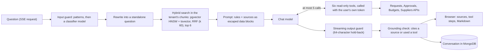

**Retrieval (RAG, built by hand).**

1. *Ingestion.* An admin uploads a policy (Markdown, or PDF read with PdfPig). The document guard checks it for hidden
   instructions first (a poisoned document is Flagged, never indexed). It is cut into parent sections and child chunks
   (300 to 800 tokens, 12 % overlap, a table is never split); each child gets a one-line context and is embedded at 1 536
   dimensions, with the model name stored per chunk. A replaced document keeps its old version searchable until the new
   one is Ready, and unchanged chunks reuse their embeddings (content hash). Progress is pushed live to the admin screen.
2. *Past purchases.* When a request completes, its title, lines, supplier, amount and approvers become one more searchable
   chunk, cited as "PR-1043".
3. *Search.* The question is rewritten to stand on its own (follow-ups), then searched twice in the caller's tenant only:
   by vector similarity and by full text. The two lists are merged by reciprocal rank fusion; the six best children bring
   their parent section into the prompt as numbered sources `[S1]` to `[S6]`.
4. *Answer.* The model answers from those sources only, citing them; the answer streams to the browser as server-sent
   events (`sources`, `tool_call`, `tool_result`, `delta`, `done`). Stop keeps what was written; regenerate and edit
   replace the last answer. One answer at a time per conversation (a Redis lock), 50 questions a day (SAST), 800 output
   tokens. Every model call has a timeout and a circuit breaker (`AI:Resilience`): when the provider is down, the stream
   ends with "The assistant is unavailable right now." at once instead of a hung spinner.

**Tools act as the user, never as the service.** `get_request_status`, `explain_approval_chain`, `get_budget` and
`get_supplier` call the other services with the signed-in user's token relayed (`AddProcureAiUserClient`), so the callee's
own permission checks and tenant filters decide what the model can see: the assistant shows exactly what the API would
show that user (a user without `budgets.read` gets "you don't have access" from `get_budget`). Requests are scoped by
tenant, so anyone with `requests.read` sees every request of their company, here as in the app. `search_policy` and
`find_similar_purchases` search the Assistant's own index in the user's tenant; past purchases (as sources and through the
tool) only for users with `requests.read` in the runtime permission matrix.

**Guardrails, in layers.**

| Layer | What it does |
|---|---|
| 1. Least privilege | Tools are read-only and run with the user's own permissions; every search and every chunk is filtered by tenant. |
| 2. Input guard | Known injection patterns, then a small classifier prompt (injection, off-topic, safe); a blocked question never reaches the answer model. |
| 3. Indirect injection | Policy documents and invoice PDFs are checked before indexing or scanning; sources and tool results enter the prompt as escaped `<data>` blocks marked as data, not instructions. |
| 4. Scope prompt | The model answers only procurement questions, only from the sources, and says so when the policy does not cover it. |
| 5. Output guard | The answer is checked while it streams (emails, phone numbers, secrets); a 64-character hold-back means nothing is shown before it is checked. Then the grounding rule: an answer that cites no source and used no tool is replaced. |
| 6. Monitoring | Every block is counted by stage and reason (`assistant.guard_blocks`) and stored with the conversation. |
| 7. Tests | A red-team set (attacks that must be blocked, harmless questions that must pass) runs as unit and integration tests. |

**Telemetry.** Every model call is an OpenTelemetry GenAI span (model, tokens, duration) in the same trace as the request
and the tool calls; prompt and answer text are only recorded when `AI:Telemetry:LogContent` is switched on. Metrics:
`assistant.tokens`, `assistant.cost_usd` (from configured prices), `assistant.tool_calls`, `assistant.guard_blocks`,
`assistant.time_to_first_token`, `assistant.questions`. Logs never contain the question or the answer.

**Invoice scanning.** A PDF dropped on the invoices screen is read to text, checked by the prompt guard (a PDF that
contains instructions is refused: "This PDF contains instructions, not an invoice."), and read by the model into a typed
invoice (supplier, VAT number, number, date, order number, lines, totals). The model's numbers are never trusted: lines
and VAT are recalculated, differences become warnings and lower the confidence. The scan prefills the invoice form (the
order it names is chosen when the user can see it), and nothing is saved until the user checks and saves it.

**Evaluation.** `tests/ProcureAi.Assistant.Evaluation/eval/questions.json` holds 34 questions with the policy sections
that answer them. Retrieval is tested on every run: hit@6 (an expected section among the six sources) is **1.00** on the
seeded policy with the Fake provider (the test requires 0.8). Groundedness and relevance are judged by a model with
Microsoft.Extensions.AI.Evaluation.Quality in the evaluation project; it spends tokens, so it is outside the CI loop and
skips until a real provider is configured. It has not been run yet, for that reason.

**Switching to a real model.** Set the AppHost user secrets (all optional; without them the Fake provider runs):

```powershell
$apphost = "src/AppHost/ProcureAi.AppHost"
dotnet user-secrets set "AI:Provider" "OpenAI" --project $apphost
dotnet user-secrets set "AI:Endpoint" "https://<resource>.openai.azure.com/openai/v1/" --project $apphost   # or any OpenAI-compatible endpoint
dotnet user-secrets set "AI:ApiKey" "<key>" --project $apphost
dotnet user-secrets set "AI:Chat:Model" "gpt-4.1-mini" --project $apphost
dotnet user-secrets set "AI:Embedding:Model" "text-embedding-3-small" --project $apphost   # 1 536 dimensions
```

Every chunk stores the model that embedded it, and embeddings are only reused for the same model. After the switch, replace
each policy document once (Replace on the policy documents screen) so it is embedded by the new model; the dimensions stay
1 536, so the vector index does not change.

## Admin, system status and behind the scenes

The admin menu (only for users with an `admin.*` permission) holds the screens a reviewer uses to see how the system decides and how it
is doing. Everything is tenant-scoped: an admin of Acme sees and changes only Acme.

| Screen | Permission | What it does |
|---|---|---|
| Authorization matrix | `admin.authorization` | which role has which permission (permissions are defined in code, the mapping is data in Access). A change takes effect for signed-in users within seconds: Access publishes `AccessChanged`, every service drops its cached permissions, and the browser reloads the user's permissions on the live push, so a link disappears from the menu without a reload |
| Access check | `admin.authorization` | "may Maria approve PR-0016?" runs the same rules the APIs run and lists them one by one: the permission and the role that grants it, tenant, open step, separation of duties, current approver; routing reasons are shown apart, as an explanation only. The inputs are in the address, so a link reproduces a check |
| Users and limits | `admin.users` | cost centers and approval limits per user (roles stay in Keycloak); changes are audited and reach the approval routing at once |
| Policy documents | `admin.policies` | the documents the assistant answers from |
| System status | `admin.system` | every service with its health, instances and circuit breakers (Supplier API, ERP, the AI model's four), sagas running, timeouts due, outbox backlog, dead letters, duplicates coalesced, guard blocks, alerts (finance step overdue, changed outside the app), a pgaudit summary of DDL and role statements, and a link to the Aspire dashboard. Refreshes every 5 s |
| Supplier chaos | `admin.system` | on the status screen: **Break the supplier API** makes the simulated supplier fail every call; orders keep being retried with backoff, the breaker opens (`Supplier API: OPEN (retry in 18 s)`), and **Restore now** (or the automatic restore after 5 minutes) lets the next trial call through and the breaker closes. The simulated supplier is shared, so the switch is system-wide by design: one tenant's admin breaks (and restores) it for every tenant |
| Assistant conversations | `admin.system` | every conversation of the tenant, with blocked questions marked |
| Data changes | `admin.system` | every row change in every service's database, with old and new values per column and who made it |

**How the status screen works without calling every service:** each service writes a small snapshot (health, breakers, Wolverine counts,
its business counters) to Redis every 10 s with a 30 s TTL, and Notifications merges them. A service without a fresh snapshot shows as Down;
across instances the worst breaker wins.

**Data change audit, including MongoDB.** Every captured table and collection is read by Debezium from the Postgres WAL or the MongoDB
change stream and stored by Audit. Postgres changes are matched by transaction ID to the row the app's EF Core interceptor wrote in the
same transaction; MongoDB writes carry an audit stamp (user, tenant, correlation ID) that Audit matches the change to. A change nobody
made through the app (manual SQL, a script, `mongosh`) is flagged **outside the app**, raises an alert on the status screen and links to
the change. Each request also has a **Data changes** tab next to its history: the field-level story of the request, its lines, its
budget reservation, approval steps, order and invoice, with who made each change.

**Behind the scenes (dev panel).** The user menu's **Behind the scenes** (or Alt+Shift+D) opens a bottom sheet with the app's last API
calls and what the server did with each: cache HIT or MISS with the cached answer's age (the 1-second micro-cache), a joined duplicate,
an idempotent replay, the policy that allowed it, the tenant, the instance, the ETag and a link to the call's trace in the Aspire
dashboard. The services send these headers only when asked and only when `DevPanel:Enabled` is on (the AppHost switches it on; off by
default, like every demo-only feature).

| Authorization matrix | Access check: separation of duties |
|---|---|
| 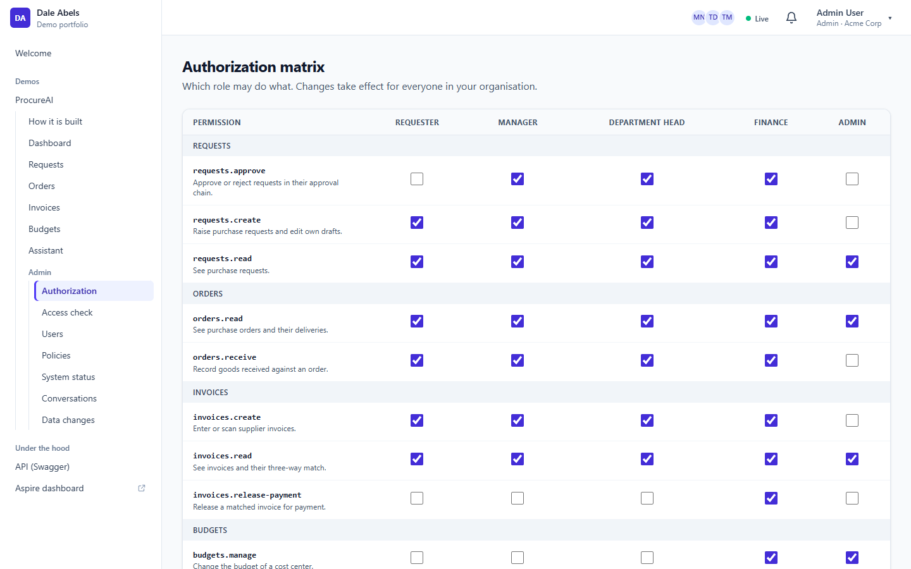 |  |
| **System status** | **Behind the scenes** |
|  | 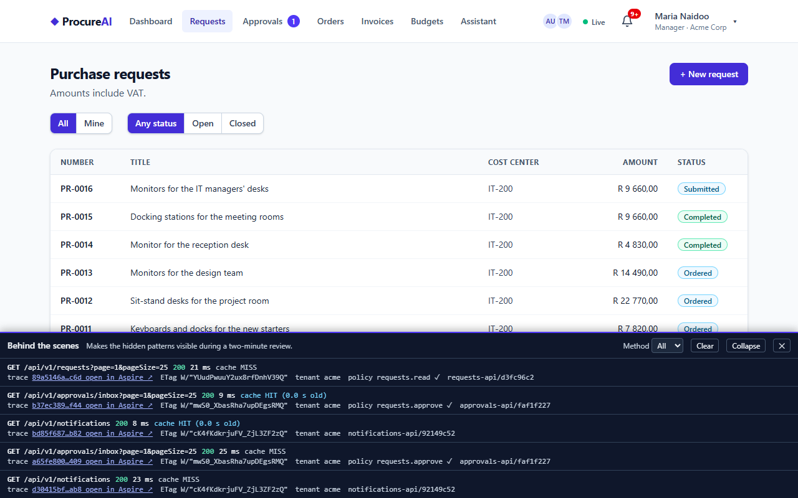 |
| **Data changes, one made outside the app** | |
|  | |

## Run it locally

Prerequisites: Docker, .NET 10 SDK, Node 24.

1. Set the AppHost user secrets once (values are yours to choose; use long random strings):

   ```powershell
   $apphost = "src/AppHost/ProcureAi.AppHost"
   foreach ($name in "keycloak-admin-password", "keycloak-demo-password", "keycloak-gateway-secret", "keycloak-internal-secret", "keycloak-access-admin-secret", "debezium-password", "simulator-api-key", "supplier-webhook-secret") {
     dotnet user-secrets set "Parameters:$name" ([Convert]::ToHexString((1..24 | % { Get-Random -Max 256 }) -as [byte[]])) --project $apphost
   }
   # admin-api-key-sha256 is the SHA-256 (hex) of the one admin API key (X-Api-Key, for scripts and tests):
   $key = [Convert]::ToHexString((1..32 | % { Get-Random -Max 256 }) -as [byte[]])
   $sha = [Convert]::ToHexString([Security.Cryptography.SHA256]::HashData([Text.Encoding]::UTF8.GetBytes($key)))
   dotnet user-secrets set "Parameters:admin-api-key-sha256" $sha --project $apphost
   # the key itself, for the demo data seeder (it calls the gateway with it):
   dotnet user-secrets set "Parameters:admin-api-key" $key --project $apphost
   ```

   The end-to-end and system tests also read the key itself from the `DEMO_ADMIN_API_KEY` environment variable.
2. Start everything: `dotnet run --project src/AppHost/ProcureAi.AppHost`
3. Open the Aspire dashboard link printed in the console, then the `gateway` endpoint to use the app.

After pulling changes to a demo seed, reset the local data volumes once: the seed only adds rows that are missing, so an old
volume keeps old rows (for example the sandbox cost center DEMO-100 without its manager).

Memory and CPU caps for every container come from the `Resources` section of the AppHost `appsettings.json`.

**Resource needs (measured 2026-11-01 with plan 06 complete: the whole system idle after the demo data seed, `docker stats --no-stream`
plus the working sets of the .NET processes):**

| Part | Memory |
|---|---|
| Containers: eight Debezium Servers (0.28 to 0.31 GB each: seven Postgres databases and MongoDB) | 2.4 GB |
| Containers: Keycloak 0.67, MongoDB 0.40, Postgres with pgvector and pgaudit 0.34, RabbitMQ 0.15, Mailpit and Redis 0.04 | 1.6 GB |
| **All containers** | **3.9 GB** |
| Ten services (Requests 0.48, Invoicing 0.48, Purchasing 0.48, Notifications 0.44, Approvals 0.38, Suppliers 0.38, Assistant 0.35, Access 0.33, Budgets 0.32, Audit 0.31) | 3.9 GB |
| Gateway 0.17, simulators 0.11, AppHost 0.20 | 0.5 GB |
| **All .NET processes of the system** | **4.3 GB** |
| Local development only: Aspire's DCP and its proxies (1.7), the `dotnet run` launchers and the Angular dev server | about 3 GB |

So the system itself needs about 8.2 GB (the eighth Debezium Server, for MongoDB, adds about 0.3 GB); a deployment without the local
tooling fits a 16 GB VM. Running it locally under Aspire takes about 11 GB. Postgres runs with `max_connections` 200 locally
(`Resources:Postgres:MaxConnections`): ten services with a few connection pools each went past the default of 100 during the seed. The
figures above were measured just before that change, with 100; the extra idle connections add little (Postgres used 0.34 of its 0.75 GB
cap with about 115 connections open).

## Demo users

**One click:** the welcome page shows **Try a demo role** buttons. Each signs you in as one demo user, no password typed.
Or sign in through Keycloak as usual; the demo password is the `keycloak-demo-password` parameter you set above.

| Button | User | Tenant | Role |
|---|---|---|---|
| Requester (Tom) | tom@acme.test | Acme | requester |
| Manager (Maria) | maria@acme.test | Acme | manager |
| Department head | dept@acme.test | Acme | department-head |
| Finance (Thandi) | thandi@acme.test | Acme and Globex | finance in both (**Switch company** in her user menu) |
| Admin | admin@acme.test | Acme | admin |
| Globex manager (Ben) | ben@globex.test | Globex | manager |
| (Keycloak login only) | approver@demo.test | Demo | manager (approves requests on the sandbox cost center DEMO-100 of self-registered users) |

How the buttons work: the gateway (`POST /bff/demo-login` with `{ "user": "tom" }`, XSRF header required) signs the user in with
the OAuth password grant on a **separate** Keycloak client, `procure-demo-login` (confidential, direct access grants only, no
browser flow), and then creates exactly the session the normal code-flow login creates: tokens in the Redis ticket store, the
same `__Host-` cookie, claims, refresh and logout. The browser only ever sends a key from the configured list (`DemoLogin:Users`
in the gateway's appsettings); the username and password come from the gateway's configuration. The password grant is deprecated
in OAuth 2.1, so it is used for these listed demo users only and is **off by default** (`DemoLogin:Enabled`): when off, both
`/bff/demo-login` endpoints answer 404 and the welcome page shows no buttons. The AppHost switches it on and generates the demo
client's secret on the first run (AppHost user secret `Parameters:keycloak-demo-login-secret`).

### Demo data

On every start the AppHost runs `demo-data` (`tools/ProcureAi.DemoData seed`) once the gateway is healthy. It drives purchase
requests through every state in both companies through the **public APIs, via the gateway**: the admin API key acts on behalf of the
demo users (`X-On-Behalf-Of-User`), so Tom raises and submits, Maria and Dept approve, Tom receives and Thandi pays, and every record
has its saga, budget reservation, events, audit trail and data changes, exactly as if the people had clicked. The scenarios are data
(`tools/ProcureAi.DemoData/Scenarios/acme.json`, `globex.json`, one request per state: draft, waiting for the manager, the department
head or finance, rejected by the manager, rejected over budget, cancelled, ordered, partly received, received, invoiced and matched,
price mismatch, partly paid, completed, closed short; Globex: waiting, ordered, completed, rejected). Maria's own request on IT-200
("Monitors for the IT managers' desks", PR-0016 on fresh data) shows separation of duties: the **Access check** answers that Maria may
not approve it because she raised it, so it waits for the department head.

The seed is safe to run again: it finds each request by title and requester and resumes it from where it is, and every write carries the
Idempotency-Key `demo:<tenant>:<key>:<step>`, so nothing is created twice. It ends with exit code 0, or 1 naming the request and the
step that failed. It takes about two minutes on a fresh start (the simulated supplier confirms after 3 s and invoices after 20 s).

### Nightly reset

Reviewers can change anything, so the demo starts fresh every night at 02:00 (Africa/Johannesburg): `ProcureAi.DemoData reset` first checks
that every service and the simulators have the reset switched on (else it stops before touching anything), then resets the
simulators, then every service in parallel through its internal `POST .../internal/demo/reset` (admin key or service account only, and
404 unless `DemoReset:Enabled`), then Audit last, and seeds again. The users who registered themselves into the Demo company stay;
Keycloak is not touched. Each service deletes with its normal write paths, so the audit trail shows the reset as the app's own changes,
never as "changed outside the app". `ProcureAi.DemoData schedule` runs it every night; locally, the dashboard command **Reset demo data**
on the `demo-data` resource runs it once. There is no reset button in the app.

### Try the invoice scan

Acme's first order, **PO-1001**, is seeded from Fabrikam Office: 2 × USB-C Dock and 2 × Laptop Stand, received in full. Fabrikam posts
PDF invoices instead of sending invoice webhooks (`Simulators:Supplier:ManualInvoiceSuppliers`), so PO-1001 waits for its invoice. The
sample invoice [`docs/samples/invoice-PO-1001.pdf`](docs/samples/invoice-PO-1001.pdf) (Fabrikam Office, R 6 992,00 incl. VAT) names it:

1. Sign in as tom@acme.test and open **Invoices**.
2. Drop the sample PDF on **Scan an invoice**, then **Review and save**: PO-1001 is chosen, the invoice number, date, quantities and
   total are filled in, and nothing is saved until you press **Save invoice**.

The end-to-end test `Tom_scans_invoice_reviews_and_saves` scans the same invoice (`tests/ProcureAi.EndToEndTests/InvoicePdf.cs`,
`FabrikamPo1001`); `SampleInvoiceTests` keeps the committed PDF the same (`UPDATE_SAMPLES=1` writes it again).

## Tests and CI

`dotnet test --project tests/<project>` per project (xUnit v3 on Microsoft.Testing.Platform). Unit, architecture
(layer rules), Testcontainers integration tests (Postgres, Redis, Keycloak, RabbitMQ), an Aspire AppHost test, and
Playwright end-to-end tests (live approval without reload, presence, conflict dialog, forbidden pages, logout isolation, reconnect,
the assistant's streamed answer and Stop, policy upload to Ready, invoice scan to a saved invoice, each demo role's menu, the full
flow from request to payment through the UI only, a matrix change reaching a signed-in user within 10 s, the access check, the chaos
switch opening and closing the breaker, an SQL change behind the app's back on the data changes and status screens, the company switch,
and the dev panel's cache HIT and trace link), about 770 Vitest specs for the Angular app, plus a system test (`dotnet run --project tests/ProcureAi.SystemTests`) that starts the
whole AppHost and drives a request through approval, purchasing, invoicing and audit, and asks the assistant through the
gateway. The assistant's retrieval is measured on every run (hit@6 on 34 questions); its model-judged evaluation
(`tests/ProcureAi.Assistant.Evaluation`, groundedness and relevance) needs a real provider and is run by hand. GitHub Actions builds with warnings as errors and fails
the build if any of the services' OpenAPI documents (found by convention, so a new service is covered
automatically) or the generated Angular clients differ from what is committed. The test suites
are run locally before every push; their CI steps are switched off until the app is complete and will be re-enabled
before this repo goes public. CI generates random, per-run secrets; nothing sensitive is stored in the repo.

## Design decisions

- **BFF token handler at the gateway.** The browser only holds an HttpOnly, SameSite=Strict session cookie; tokens
  live server-side in Redis, with CSRF protection. Every service still validates the JWT itself.
- **Transactional outbox via Wolverine on Postgres.** State change and event commit together, so nothing is lost
  or published twice.
- **Idempotent writes and request coalescing.** POSTs need an `Idempotency-Key`; identical concurrent requests run
  once, across instances (FusionCache, Redis, distributed lock).
- **1-second micro-cache on every GET** absorbs bursts without visible staleness. One deliberate exception: Access's
  internal lookups for other services, which those services already cache per tenant generation (a micro-cached answer
  could outlive the `AccessChanged` event that revokes it).
- **Notifications has no database, on purpose.** Live pushes, presence and bell items are not business data, so
  Notifications listens to RabbitMQ with a plain consumer instead of the durable inbox (which would need Postgres). A
  duplicate message gives a duplicate push, and the client just refetches; emails are deduplicated by message ID in Redis.
  The cost: an email can be lost if the service dies between acknowledging a message and sending it. This is a deliberate
  exception to "every consumer uses the inbox"; everything that changes business state still does.
- **Two-layer data audit.** An EF Core interceptor records who changed what in the same transaction; Debezium reads
  the Postgres WAL so changes made outside the app are caught too.
- **Caller model: acting vs initiating.** Every handler knows who the action is *for* (the user) and who actually
  *performed* it (a user, a service, or the admin API key). Both reach the audit trail, so a service acting for a user
  or the admin key on behalf of a user is never mistaken for that user.
- **Client credentials between services.** Service-to-service calls use Keycloak client-credentials tokens, with the
  calling service and the user and tenant it acts for carried in headers; messages carry IDs, never tokens.
- **One Debezium Server per database.** Debezium Server reads one database per instance, so each captured database has
  its own small one. That keeps true database-per-service with no shared capture pipeline.
- **Interceptor rows matched against CDC.** An EF Core interceptor writes an audit row in the same transaction as each
  change; Audit matches every Debezium change to that row by transaction ID. A change with no matching row was made
  outside the app (manual SQL, a script) and is flagged.
- **Marten for audit.** Audit stores events and change records as documents in Postgres with Marten, where an
  append-only, query-by-request model fits better than relational tables.
- **Orchestrated saga in Approvals.** One saga per request drives budget reservation, the approval steps, reminders,
  escalation and compensation (budget release), with timeouts scheduled durably by Wolverine. The flow is in one place
  instead of spread across choreographed handlers.
- **Fiscal year in SAST.** A budget's fiscal year runs 1 March to the end of February in `Africa/Johannesburg` time, so a
  request submitted late on 28 February is judged by the South African calendar, not UTC.
- **Generated API client.** Angular calls are generated from each service's OpenAPI document (ng-openapi-gen, one client
  per service) and CI guards against drift of those clients and of the OpenAPI documents. The only hand-written HTTP is the
  BFF's own endpoints and the SignalR hub.
- **Event-carried order lines.** The request's lines are frozen when it is submitted and travel inside the saga's
  `CreatePurchaseOrder` command, so Purchasing builds the order without calling Requests back and keeps working when
  Requests is down.
- **The catalog is the price source.** Prices come from the Suppliers catalog, not from the requester, so a request
  cannot name its own price.
- **Purchasing decides cancellation.** Only Purchasing knows whether goods have arrived, so it alone accepts or refuses
  a cancel (allowed until the first receipt); the request shows Cancelling until its answer, then Cancelled (budget
  released) or back to Ordered.
- **Tombstones.** A cancel that overtakes the order's creation stores a cancelled placeholder order, so the create that
  follows does nothing; no race can resurrect a cancelled request.
- **Never-give-up supplier delivery with a circuit breaker.** A failed send (timeout, 5xx, open breaker) is recorded on
  the order and rescheduled with backoff until the supplier answers or the order is cancelled; the breaker stops
  hammering a down supplier. The order shows "Supplier unavailable, retrying" instead of failing.
  - *Known limit:* once the supplier has accepted the order, its confirmation arrives by webhook only. If that webhook is
    lost (the simulator gives up after its first try and 3 retries, about 36 s, for example while Purchasing restarts), the
    order stays "Sent to supplier": nothing polls the supplier or re-sends after a timeout. Nothing is stuck for good, because
    the requester can still cancel the request. A production system would re-send after a while (the supplier deduplicates
    by our order ID) or poll the supplier's order status.
- **Signed webhooks with a replay inbox.** Webhooks carry an HMAC-SHA256 signature over a timestamp and the body (5 minute
  tolerance, constant-time compare), and each event ID is stored in the same transaction as its effect, so forged,
  stale and replayed calls change nothing.
- **Cumulative three-way match.** Each invoice is matched against what was ordered and received minus what earlier
  invoices already claimed, so several invoices per order and partial deliveries work.
- **Payments at order price, with separation of duties.** Finance pays quantities at the order's price, never above it, and the
  requester of a request cannot release its payment (like approvals).
- **Spend per payment.** Budgets record spend for each payment (idempotent by payment ID), so
  partial payments and the leftover release give the same totals in either order.
- **MongoDB catalog with tenant collections.** Catalog data is documents and publishes no events, which suits MongoDB;
  one tenant-scoped collection wrapper makes the tenant filter impossible to forget.
- **RAG built by hand on Microsoft.Extensions.AI.** Chunking, contextual embeddings, hybrid search with rank fusion, the prompt
  and the citations are our own code over `IChatClient` and `IEmbeddingGenerator`, not a managed "file search", so every step
  is visible, testable and tenant-filtered. The provider is configuration (`AI:Provider`).
- **A deterministic Fake provider, on purpose.** Tests and CI never spend tokens, and the demo runs without any AI account.
  It also became the demo's model when GitHub Models was retired (2026-07-30); a real provider needs an account, so that is
  the owner's decision, and the UI says "Demo model" honestly until then.
- **Tools as the user.** The model's tools relay the user's own credential, so they can never see more than the user could
  in the app; a service identity would have needed its own, broader permissions.
- **Guards that stream.** The output guard holds back the last 64 characters of the stream, so a phone number or an email
  split across chunks is caught before any of it is shown, at the cost of a slightly later first word.
- **Never trust the model's numbers.** An invoice scan is recalculated and only prefills a form the user must save.
- **Libraries that went commercial are avoided:** Wolverine instead of MassTransit v9, Mapperly instead of
  AutoMapper, plain handlers instead of MediatR, Shouldly instead of FluentAssertions, and YARP with ASP.NET Core's
  OIDC handlers instead of Duende BFF.
