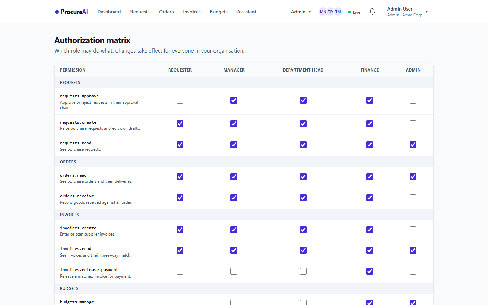
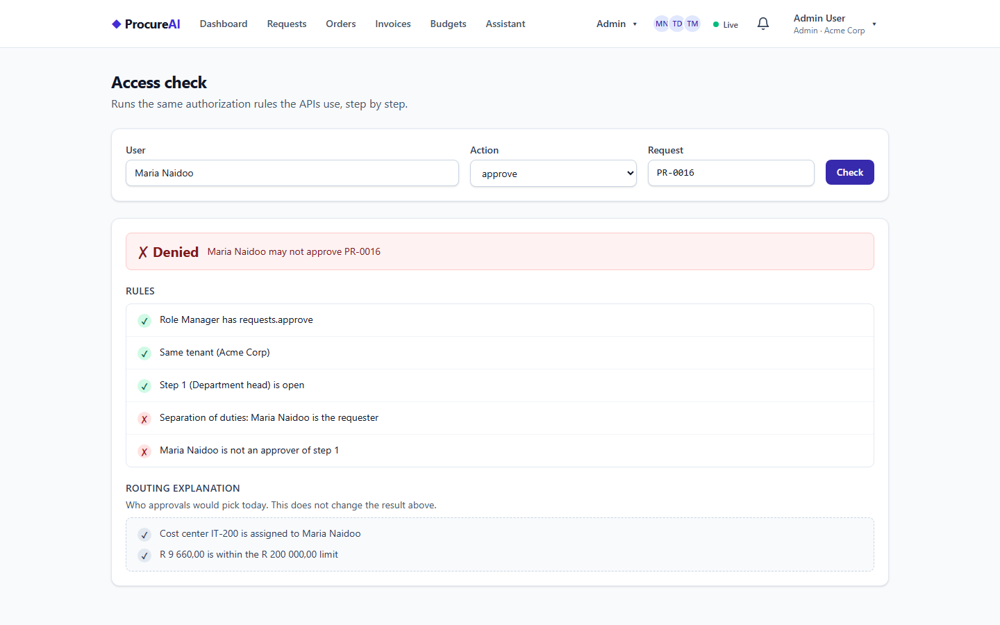
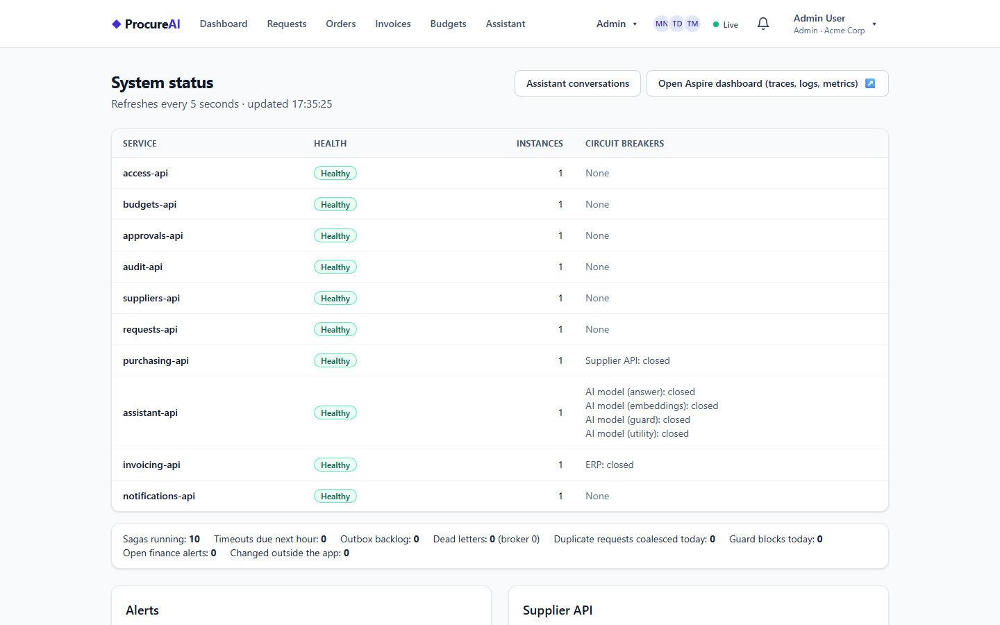
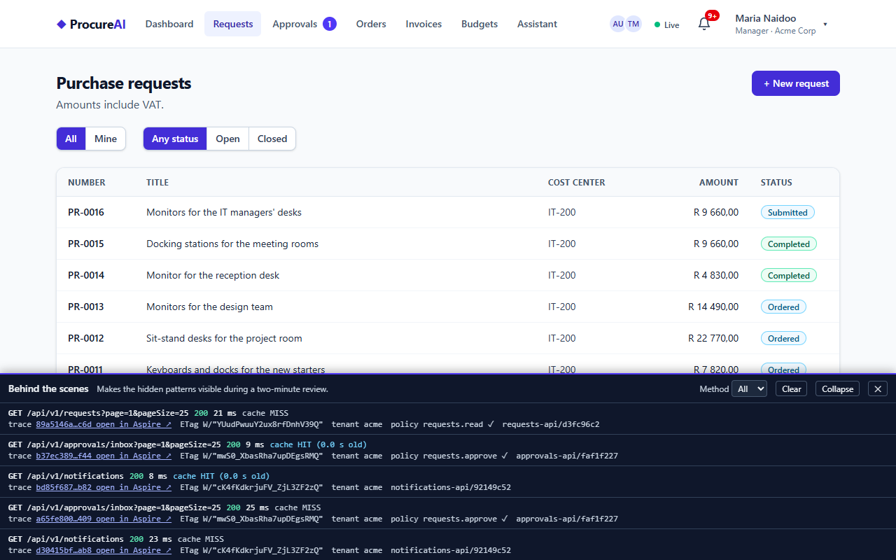
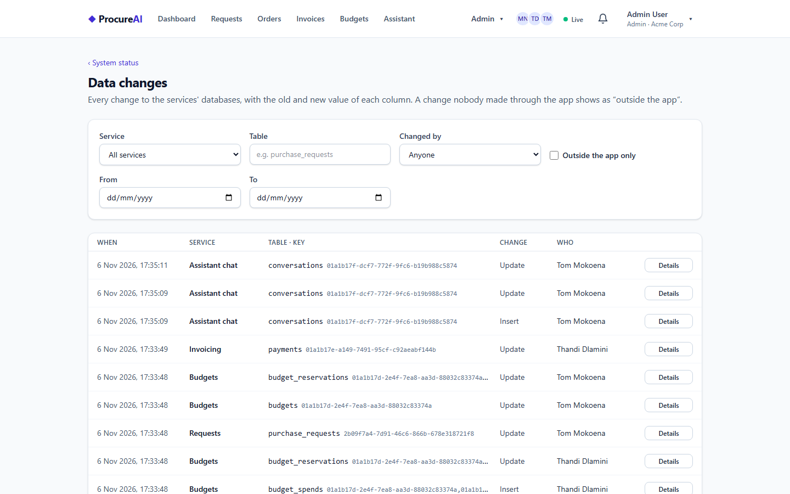

# Admin, system status and behind the scenes

The screens a reviewer uses to see how the system decides and how it is doing. Back to the [README](../README.md).

## Admin, system status and behind the scenes

The admin menu (only for users with an `admin.*` permission) holds the screens a reviewer uses to see how the system decides and how it
is doing. Everything is tenant-scoped: an admin of Acme sees and changes only Acme.

| Screen | Permission | What it does |
|---|---|---|
| Authorization matrix | `admin.authorization` | which role has which permission (permissions are defined in code, the mapping is data in Access). A change takes effect for signed-in users within seconds: Access publishes `AccessChanged`, every service drops its cached permissions, and the browser reloads the user's permissions on the live push, so a link disappears from the menu without a reload |
| Access check | `admin.authorization` | "may Maria approve PR-0016?" runs the same rules the APIs run and lists them one by one: the permission and the role that grants it, tenant, open step, separation of duties, current approver; routing reasons are shown apart, as an explanation only. The inputs are in the address, so a link reproduces a check |
| Users and limits | `admin.users` | cost centers and approval limits per user (roles stay in Keycloak); changes are audited and reach the approval routing at once |
| Policy documents | `admin.policies` | the documents the assistant answers from |
| System status | `admin.system` | every service with its health, instances and circuit breakers (Supplier API, ERP, the AI model's four), sagas running, timeouts due, outbox backlog, dead letters, duplicates coalesced, guard blocks, alerts (finance step overdue, changed outside the app), a pgaudit summary of DDL and role statements, and a link to the Aspire dashboard. Refreshes every 5 s |
| Supplier chaos | `admin.system` | on the status screen: **Break the supplier API** makes the simulated supplier fail every call; orders keep being retried with backoff, the breaker opens (`Supplier API: OPEN (retry in 18 s)`), and **Restore now** (or the automatic restore after 5 minutes) lets the next trial call through and the breaker closes. The simulated supplier is shared, so the switch is system-wide by design: one tenant's admin breaks (and restores) it for every tenant |
| Assistant conversations | `admin.system` | every conversation of the tenant, with blocked questions marked |
| Data changes | `admin.system` | every row change in every service's database, with old and new values per column and who made it |

**How the status screen works without calling every service:** each service writes a small snapshot (health, breakers, Wolverine counts,
its business counters) to Redis every 10 s with a 30 s TTL, and Notifications merges them. A service without a fresh snapshot shows as Down;
across instances the worst breaker wins.

**Data change audit, including MongoDB.** Every captured table and collection is read by Debezium from the Postgres WAL or the MongoDB
change stream and stored by Audit. Postgres changes are matched by transaction ID to the row the app's EF Core interceptor wrote in the
same transaction; MongoDB writes carry an audit stamp (user, tenant, correlation ID) that Audit matches the change to. A change nobody
made through the app (manual SQL, a script, `mongosh`) is flagged **outside the app**, raises an alert on the status screen and links to
the change. Each request also has a **Data changes** tab next to its history: the field-level story of the request, its lines, its
budget reservation, approval steps, order and invoice, with who made each change.

**Behind the scenes (dev panel).** The user menu's **Behind the scenes** (or Alt+Shift+D) opens a bottom sheet with the app's last API
calls and what the server did with each: cache HIT or MISS with the cached answer's age (the 1-second micro-cache), a joined duplicate,
an idempotent replay, the policy that allowed it, the tenant, the instance, the ETag and a link to the call's trace in the Aspire
dashboard. The services send these headers only when asked and only when `DevPanel:Enabled` is on (the AppHost switches it on; off by
default, like every demo-only feature).

| Authorization matrix | Access check: separation of duties |
|---|---|
|  |  |
| **System status** | **Behind the scenes** |
|  |  |
| **Data changes, one made outside the app** | |
|  | |
