# Architecture and flows

How the services fit together, what each one owns, the screens of the app and the two main business flows. Back to the [README](../README.md).

## Architecture at a glance

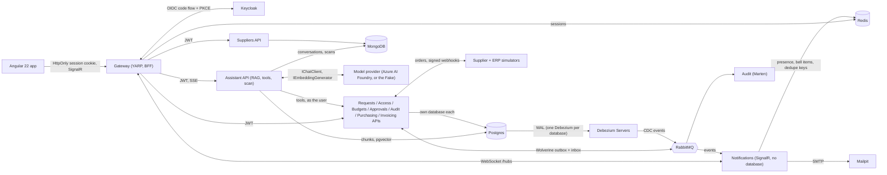

Everything is orchestrated by .NET Aspire locally; logs, traces and metrics (OpenTelemetry) show in the Aspire dashboard.

## Services

| Service | Purpose | Data store |
|---|---|---|
| Requests | Purchase requests and their lines; draft, edit, submit, cancel | Postgres |
| Access | Role to permission matrix, cost-center approvers and approval limits, tenants | Postgres |
| Budgets | Cost-center budgets per fiscal year, reservations, release on reject or cancel | Postgres |
| Approvals | Approval chain, the approval saga, reminders and escalation, approver inbox | Postgres (saga state) |
| Audit | Business-event history, data-change audit matched to Debezium CDC | Marten (Postgres) |
| Suppliers | Supplier catalog and prices per tenant; read through its API by others, publishes no events | MongoDB |
| Purchasing | One purchase order per approved request, supplier delivery, goods receipt per line, cancellation | Postgres |
| Invoicing | Invoices (by webhook or entered), three-way match, payment export to the ERP | Postgres (invoice documents in `jsonb`) |
| Notifications | Live pushes (SignalR), presence ("Maria is viewing"), bell items and approval emails; **no database** | Redis |
| Assistant | Policy assistant (RAG over policy documents and past purchases, six read-only tools), policy document ingestion, invoice scanning | Postgres + pgvector, MongoDB (conversations, scans) |
| Simulators | Supplier and ERP stand-ins, deliberately slow and flaky | none |
| Gateway | YARP reverse proxy, BFF login, WebSocket proxy for the hub, Swagger UI with one definition per service | Redis (sessions) |

## The app

A client-side Angular 22 app (no SSR: every page after login is per user), Tailwind CSS with Angular Aria, NgRx
SignalStore for state, and API clients generated from each service's OpenAPI document. Money is Rand, shown the
South African way (`R 86 940,00`). What each role sees comes from permissions, not role names.

The app sits in a portfolio frame with a left menu: a public **Welcome** page (`/`), the **Procurement demo** start page with the
demo-role buttons (`/demos/procurement`), **How it is built** (`/demos/procurement/about`: diagram and technology), and under
"Under the hood" links to the API (Swagger) and the Aspire dashboard. The signed-in app lives under `/app/...`.

| Screen | Who | What it shows |
|---|---|---|
| Dashboard | everyone | tiles for what the user may see (approvals waiting, my open requests, budget used, invoices with a mismatch), recent activity, who is online |
| Requests, new request | requesters, managers, finance | list with filters; a form with a live budget check, the approvers preview and VAT |
| Request detail | everyone with `requests.read` | workflow timeline, audit trail, items, cancel, "Maria is also viewing" |
| Approvals | approvers | the inbox; approve or reject, with a conflict dialog when someone else got there first |
| Orders | requesters (their own), finance | orders with their supplier status, goods receipt per line, close short |
| Invoices and match | finance | three-way match per line, payment release, manual invoice entry |
| Budgets | requesters (their cost center), finance, admin | per cost center: budget, spent, reserved, available; edit with a floor check |
| Assistant | everyone with `assistant.use` | conversations; the answer streams with its sources, the tools it used and Markdown tables; Stop, regenerate, edit |
| Policy documents | admins | upload, replace and remove the documents the assistant answers from, with live ingestion progress |
| Invoice scan | everyone with `invoices.create` | drop a PDF on the invoices screen; the scan prefills the entry form, the order it names is chosen |
| Admin screens | admins | see [Admin, system status and behind the scenes](admin.md) |

| Dashboard (live) | Request detail with presence |
|---|---|
| 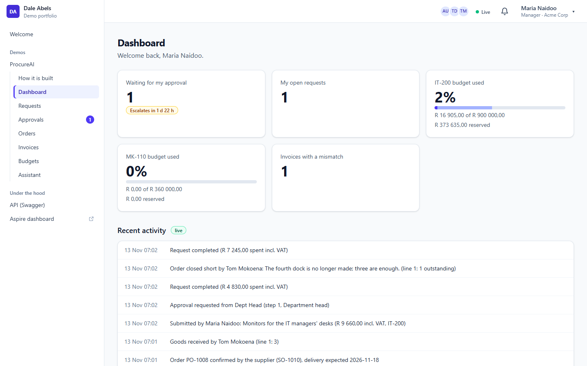 | 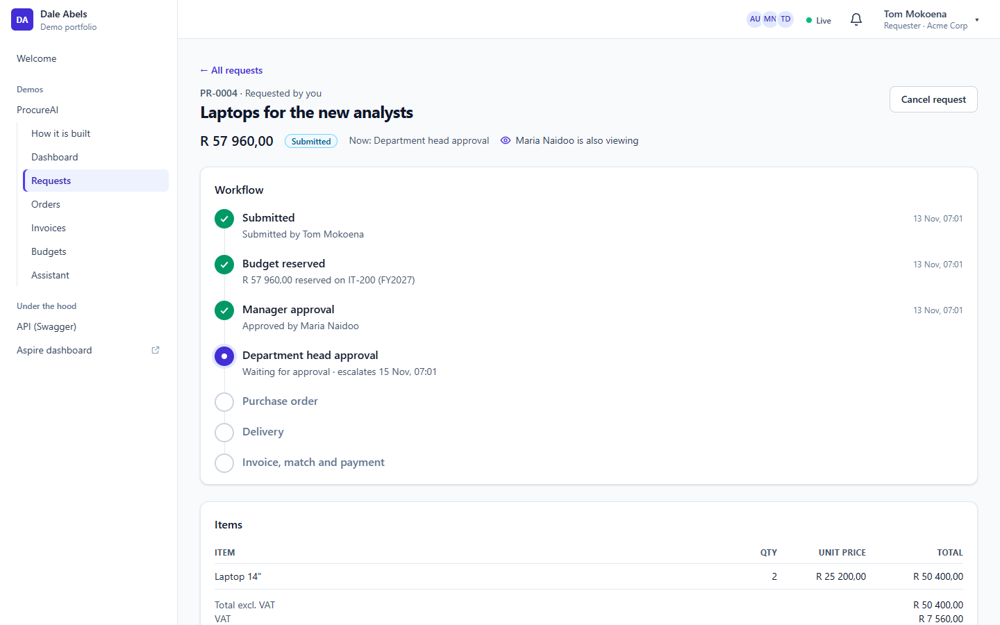 |
| **Approvals inbox** | **Order and goods receipt** |
| 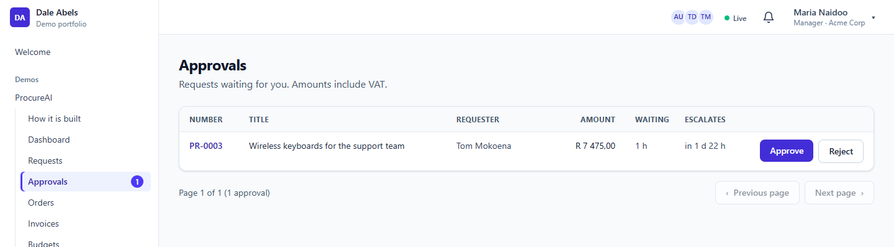 | 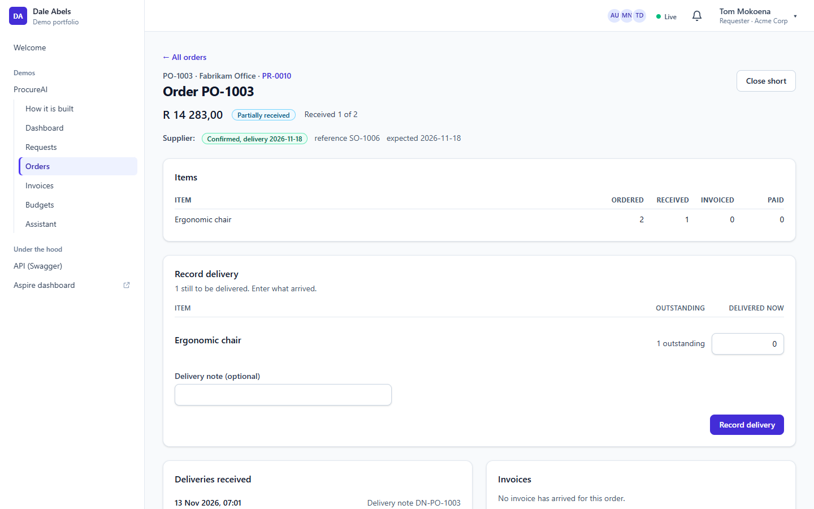 |
| **Three-way match** | **Budgets** |
| 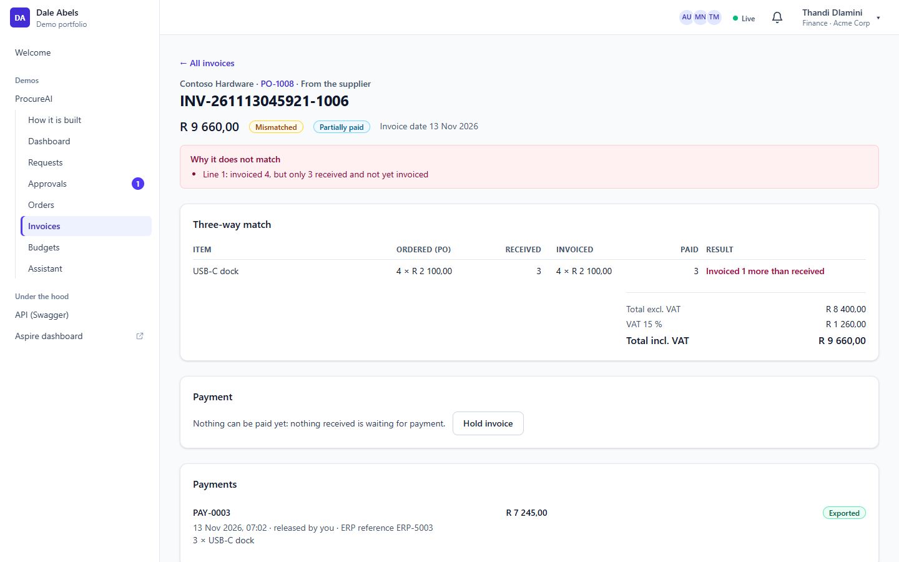 | 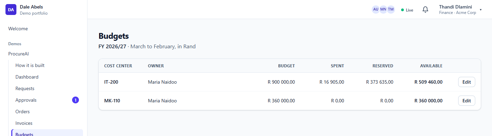 |
| **Assistant: sources, a tool step and a quoted table** | **Policy documents** |
| 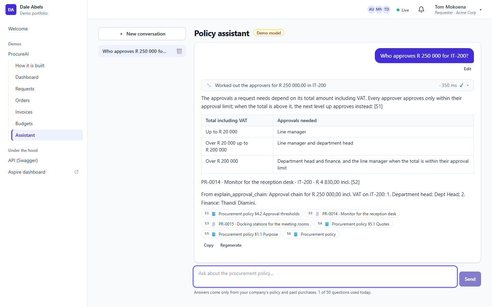 | 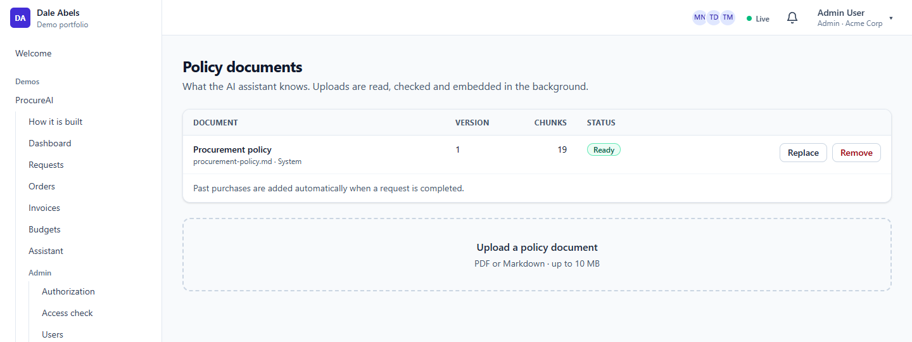 |
| **Invoice scan, prefilled for review** | |
| 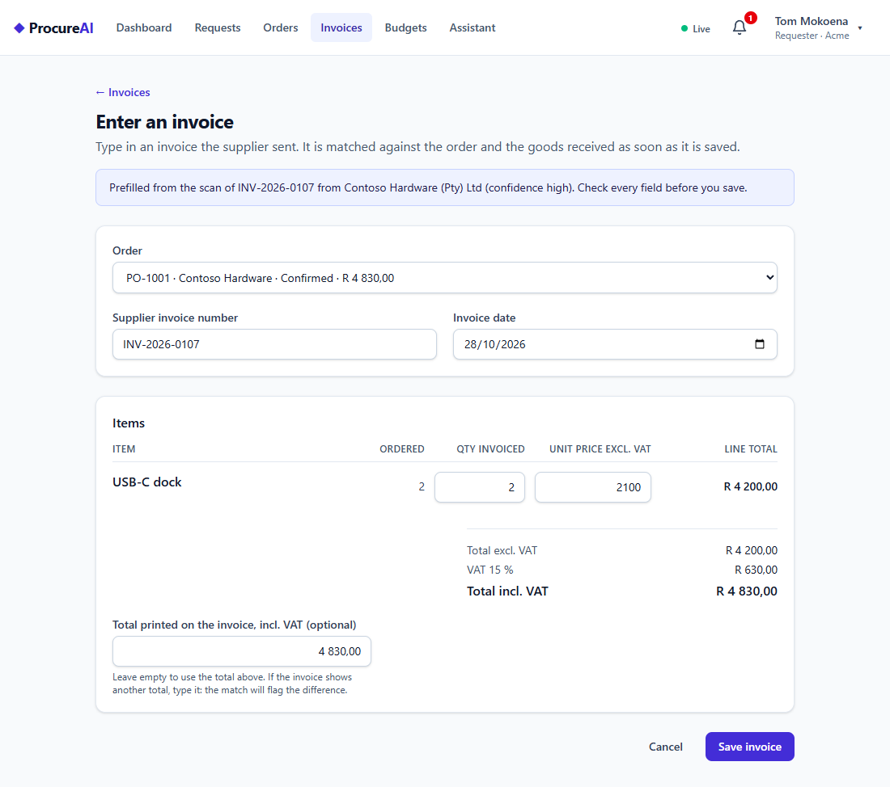 | |

### Live updates and presence

The page you are looking at changes when somebody else acts, with no reload and no polling.

- **Pushes carry IDs only.** When an event happens, Notifications sends `EntityChanged { entity, id, ... }` over
  SignalR to the tenant's group. The browser refetches through the normal, authorized APIs, so a push can never leak data
  the reader may not see. The hub is reached through the gateway (WebSockets, same cookie session), and the tenant comes
  from the token, never from the client.
- **Stores revalidate, they don't poll.** Each SignalStore shows what it has at once, refreshes in the background
  (stale-while-revalidate, 30 s by default, a whole session for reference data), shares identical in-flight requests,
  and refetches just the item a push names. Everything is cleared on logout.
- **Presence.** "Maria is also viewing" on a request and the avatars of who is online come from Redis with a 15 s
  heartbeat and a 45 s TTL, so a crashed browser tab drops off by itself. The header shows Live, Reconnecting or
  Offline; after a reconnect every store revalidates what it holds.
- **Conditional GETs.** Every GET carries an ETag and `Cache-Control: private, no-cache`; the browser revalidates with
  `If-None-Match` and gets a 304 when nothing changed. No Angular code involved, and the logout clears the browser cache
  (`Clear-Site-Data`) so the next user in the same tab sees none of it.
- **Writes wait for the server.** Approve, reject, pay and receive show a busy state and send `Idempotency-Key` and
  `If-Match`; a stale write gets a conflict dialog and the latest version.

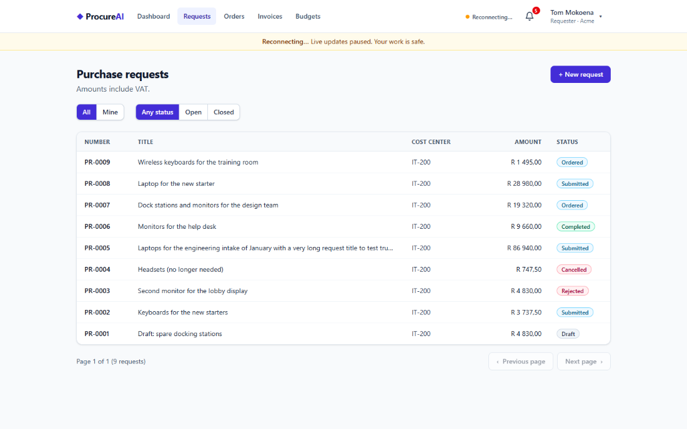

## The approval flow

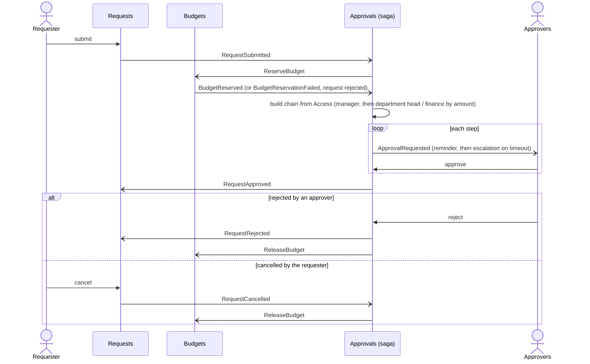

Each service that publishes events writes its state and those events in one transaction (Wolverine outbox), and Audit
records every event.

## From order to payment

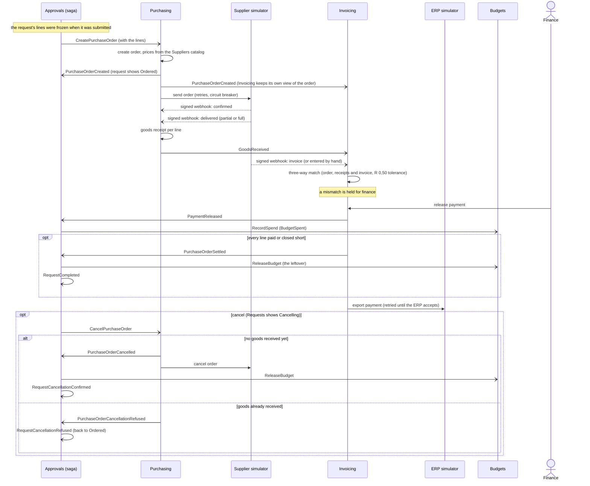

Arrows to Approvals are the saga's input; "RequestCompleted" and the cancellation answers are events the saga publishes
for Requests and the audit trail.
