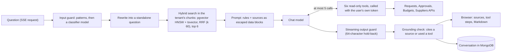

# The AI assistant

RAG built by hand on Microsoft.Extensions.AI, tools that act as the user, layered guardrails and invoice scanning. Back to the [README](../README.md).

## The AI assistant

The Assistant service answers questions about the procurement policy and the company's past purchases, cites where every
fact comes from, and can look things up (a request's status, who must approve an amount, a budget) **as the person asking**.
It also reads supplier invoices from PDF. All AI calls go through Microsoft.Extensions.AI (`IChatClient`,
`IEmbeddingGenerator`); no provider SDK type is used outside one setup class, and an architecture test keeps it that way.

> **Which model answers today: a built-in demo model.** The plan was GitHub Models for development (free), but GitHub
> retired it on 2026-07-30. A real provider (Azure AI Foundry or any OpenAI-compatible endpoint) needs a cloud account,
> which is the owner's call and has not been made yet. Until then the AppHost runs the **Fake provider**: deterministic,
> no key, no account, no cost. It is labeled **"Demo model"** in the app. It runs the whole pipeline for real (ingestion,
> embeddings, hybrid search, tools, guards, streaming, telemetry), but its "answers" are extracts: the first sentence (or
> the table or list) of the top sources, plus a summary of any tool result. Its embeddings are a hashed bag of words, so
> retrieval is lexical. Switching to a real model is configuration only (below); the code does not change.



**Retrieval (RAG, built by hand).**

1. *Ingestion.* An admin uploads a policy (Markdown, or PDF read with PdfPig). The document guard checks it for hidden
   instructions first (a poisoned document is Flagged, never indexed). It is cut into parent sections and child chunks
   (300 to 800 tokens, 12 % overlap, a table is never split); each child gets a one-line context and is embedded at 1 536
   dimensions, with the model name stored per chunk. A replaced document keeps its old version searchable until the new
   one is Ready, and unchanged chunks reuse their embeddings (content hash). Progress is pushed live to the admin screen.
2. *Past purchases.* When a request completes, its title, lines, supplier, amount and approvers become one more searchable
   chunk, cited as "PR-1043".
3. *Search.* The question is rewritten to stand on its own (follow-ups), then searched twice in the caller's tenant only:
   by vector similarity and by full text. The two lists are merged by reciprocal rank fusion; the six best children bring
   their parent section into the prompt as numbered sources `[S1]` to `[S6]`.
4. *Answer.* The model answers from those sources only, citing them; the answer streams to the browser as server-sent
   events (`sources`, `tool_call`, `tool_result`, `delta`, `done`). Stop keeps what was written; regenerate and edit
   replace the last answer. One answer at a time per conversation (a Redis lock), 50 questions a day (SAST), 800 output
   tokens. Every model call goes through a circuit breaker (`AI:Resilience`); a chat call also has its own timeout
   (`AI:Chat:Timeout`), and an embedding call only the provider SDK's network timeout per attempt. When the provider is down, the stream
   ends with "The assistant is unavailable right now." at once instead of a hung spinner.

**Tools act as the user, never as the service.** `get_request_status`, `explain_approval_chain`, `get_budget` and
`get_supplier` call the other services with the signed-in user's token relayed (`AddProcureAiUserClient`), so the callee's
own permission checks and tenant filters decide what the model can see: the assistant shows exactly what the API would
show that user (a user without `budgets.read` gets "you don't have access" from `get_budget`). Requests are scoped by
tenant, so anyone with `requests.read` sees every request of their company, here as in the app. `search_policy` and
`find_similar_purchases` search the Assistant's own index in the user's tenant; past purchases (as sources and through the
tool) only for users with `requests.read` in the runtime permission matrix.

**Guardrails, in layers.**

| Layer | What it does |
|---|---|
| 1. Least privilege | Tools are read-only and run with the user's own permissions; every search and every chunk is filtered by tenant. |
| 2. Input guard | Known injection patterns, then a small classifier prompt (injection, off-topic, safe); a blocked question never reaches the answer model. |
| 3. Indirect injection | Policy documents and invoice PDFs are checked before indexing or scanning; sources and tool results enter the prompt as escaped `<data>` blocks marked as data, not instructions. |
| 4. Scope prompt | The model answers only procurement questions, only from the sources, and says so when the policy does not cover it. |
| 5. Output guard | The answer is checked while it streams (emails, phone numbers, secrets); a 64-character hold-back means nothing is shown before it is checked. Then the grounding rule: an answer that cites no source and used no tool is replaced. |
| 6. Monitoring | Every block is counted by stage and reason (`assistant.guard_blocks`) and stored with the conversation. |
| 7. Tests | A red-team set (attacks that must be blocked, harmless questions that must pass) runs as unit and integration tests. |

**Telemetry.** Every model call is an OpenTelemetry GenAI span (model, tokens, duration) in the same trace as the request
and the tool calls; prompt and answer text are only recorded when `AI:Telemetry:LogContent` is switched on. Metrics:
`assistant.tokens`, `assistant.cost_usd` (from configured prices), `assistant.tool_calls`, `assistant.guard_blocks`,
`assistant.time_to_first_token`, `assistant.questions`. Logs never contain the question or the answer.

**Invoice scanning.** A PDF dropped on the invoices screen is read to text, checked by the prompt guard (a PDF that
contains instructions is refused: "This PDF contains instructions, not an invoice."), and read by the model into a typed
invoice (supplier, VAT number, number, date, order number, lines, totals). The model's numbers are never trusted: lines
and VAT are recalculated, differences become warnings and lower the confidence. The scan prefills the invoice form (the
order it names is chosen when the user can see it), and nothing is saved until the user checks and saves it.

**Evaluation.** `tests/ProcureAi.Assistant.Evaluation/eval/questions.json` holds 34 questions with the policy sections
that answer them. Retrieval is tested on every run: hit@6 (an expected section among the six sources) is **1.00** on the
seeded policy with the Fake provider (the test requires 0.8). Groundedness and relevance are judged by a model with
Microsoft.Extensions.AI.Evaluation.Quality in the evaluation project; it spends tokens, so it is outside the CI loop and
skips until a real provider is configured. It has not been run yet, for that reason.

**Switching to a real model.** Set the AppHost user secrets (all optional; without them the Fake provider runs):

```powershell
$apphost = "src/AppHost/ProcureAi.AppHost"
dotnet user-secrets set "AI:Provider" "OpenAI" --project $apphost
dotnet user-secrets set "AI:Endpoint" "https://<resource>.openai.azure.com/openai/v1/" --project $apphost   # or any OpenAI-compatible endpoint
dotnet user-secrets set "AI:ApiKey" "<key>" --project $apphost
dotnet user-secrets set "AI:Chat:Model" "gpt-4.1-mini" --project $apphost
dotnet user-secrets set "AI:Embedding:Model" "text-embedding-3-small" --project $apphost   # 1 536 dimensions
```

Every chunk stores the model that embedded it, and embeddings are only reused for the same model. After the switch, replace
each policy document once (Replace on the policy documents screen) so it is embedded by the new model; the dimensions stay
1 536, so the vector index does not change.
