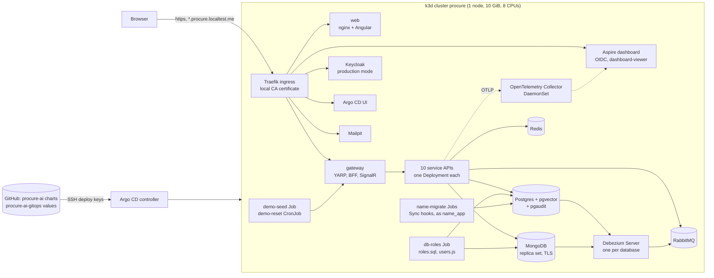

# Running procure-ai on Kubernetes

The whole system also runs on a local single-node Kubernetes cluster (k3d), deployed by Argo CD from the GitOps repo
[procure-ai-gitops](https://github.com/modefan/procure-ai-gitops). This is the same pattern as an AKS cluster managed with Argo CD:
Helm charts in this repo, environment values and the deployed revision in the GitOps repo, every change through git. The Aspire AppHost
stays the way to develop and debug; the cluster is how the system is deployed.

## The deployment at a glance



| Namespace | What runs there |
|---|---|
| `procure` | Platform (Postgres, MongoDB, Redis, RabbitMQ, Keycloak, Mailpit, eight Debezium Servers) and the apps (ten APIs, gateway, web, simulators, migration Jobs, demo data) |
| `observability` | OpenTelemetry Collector (DaemonSet: OTLP from the pods plus the pods' logs) and the standalone Aspire dashboard |
| `argocd` | Argo CD (one replica of each component; it manages itself after the bootstrap) |

The charts live in `deploy/charts/`:

| Chart | Contents |
|---|---|
| `procure-platform` | Our own small manifests (no Bitnami, no operators): StatefulSets for Postgres, MongoDB, RabbitMQ and the Debezium Servers, Deployments for Redis, Keycloak and Mailpit, network policies |
| `procure-app` | One app: Deployment, Service, ConfigMap, optional Ingress and the `<name>-migrate` Job (`--migrate`) |
| `procure-ai` | The umbrella: `procure-app` once per app (aliases) with the wiring the AppHost has, plus `demo-seed` and `demo-reset` |
| `procure-observability` | The Collector (upstream chart, pinned) and the Aspire dashboard |

Every container has requests and limits, runs as non-root with a read-only root filesystem, no privilege escalation and no
capabilities; .NET pods keep the AppHost's heap cap (`DOTNET_GCHeapHardLimit`), Java pods their `-Xmx`. Every Secret is referenced by
name and never optional, so a missing Secret key keeps the pod in `CreateContainerConfigError` instead of starting with a default.

## Hostnames and certificates

All hostnames are under `*.localtest.me`, which resolves to 127.0.0.1, so no hosts file is needed:

| Host | What |
|---|---|
| `https://procure.localtest.me` | The app (web and gateway on one origin) |
| `https://auth.procure.localtest.me` | Keycloak (issuer `https://auth.procure.localtest.me/realms/procure`) |
| `https://dashboard.procure.localtest.me` | Aspire dashboard (Keycloak sign-in; only users with the client role `dashboard-viewer`, the demo admin) |
| `https://argocd.procure.localtest.me` | Argo CD (user `admin`, password in Secret `argocd/argocd-initial-admin-secret`) |
| `https://mail.procure.localtest.me` | Mailpit (the demo's outgoing mail) |

The cluster publishes its ports on the PC's loopback address only (`127.0.0.1:80`, `127.0.0.1:443` and the Kubernetes API on
`127.0.0.1:6550`, `bootstrap/new-cluster.ps1`), never on the PC's network interfaces: Mailpit, Keycloak's admin console and Argo CD have
no protection meant for a network, so nobody else on the LAN or Wi-Fi may reach them. `tests/Test-BootstrapIsIdempotent.ps1` and
`tests/Test-Smoke.ps1` fail when a port listens on anything but 127.0.0.1 or ::1.

### Admin surfaces on a public host

Locally every host above is published. For a public host (plan 08 ruling 4) values switches close the surfaces that have no login of
their own or are not meant for the internet; the defaults keep today's local behaviour:

| Switch (default) | Where | When off / on |
|---|---|---|
| `mailpit.ingress.enabled` (`true`) | procure-platform | No Mailpit Ingress, and Traefik may not reach the pod. Open the UI with `kubectl -n procure port-forward svc/mailpit 8025` |
| `keycloak.ingress.publicPathsOnly` (`false`) | procure-platform | The Keycloak Ingress routes only `/realms/` and `/resources/` (Keycloak's public paths): no admin console, no admin REST API, no welcome page. Admin work with `kcadm.sh` in the pod ("Troubleshooting") |
| `argocd.adminEnabled` (`true`) | GitOps `apps/values.yaml`, set in `envs/<env>/apps.yaml` | Argo CD's `admin` user is disabled (no password login; use `argocd --core` or kubectl) |
| `argocd.ingressEnabled` (`true`) | same | No Argo CD Ingress; `kubectl -n argocd port-forward svc/argocd-server 8080:80` |

Who calls Keycloak on which path: browsers (login pages, `/realms/procure/protocol/openid-connect/*`, themes under `/resources/`), the
gateway (OIDC and the demo login's token request), every service API (discovery, keys, client-credentials tokens), the Aspire dashboard
(OIDC) and Swagger UI's Authorize dialog all use `/realms/procure/...` on the public host, so they work with `publicPathsOnly`. Only
Access (`/admin/realms/procure/...`, self-registration) and the `keycloak-config` Job (the realm, below) call the admin REST API: both use
Keycloak's Service `http://keycloak:8080` in both modes (`Keycloak__AdminBaseUrl`). The token it gets there still carries the public issuer (Keycloak's hostname is fixed by
`KC_HOSTNAME`), which is what the admin API checks.

### Who may connect to the gateway and Keycloak

The gateway (`ForwardedHeaders__KnownNetworks__0`) and Keycloak (`KC_PROXY_TRUSTED_ADDRESSES`) trust `X-Forwarded-For`/`-Proto` from the
whole pod network (`10.42.0.0/16`), because Traefik's pod address is not fixed. So the NetworkPolicies of `procure-platform`
(`networkPolicies.forwardedHeaderTrusting`) leave both out of the namespace-wide "pods of `procure` may reach each other" rule and let
only these connect to their `http` port (plan 08 ruling 5):

| Pod | May be reached directly by | Why |
|---|---|---|
| gateway | Traefik (kube-system), the `demo-data` Jobs | The demo seed and reset call `http://gateway:8080` with the admin key |
| Keycloak | Traefik, `access-api`, the `keycloak-config` Job | The admin REST API (above). Every other pod reaches Keycloak by its public name, which CoreDNS answers with Traefik |

Kubelet probes come from the node and are not affected (Keycloak's management port 9000 is otherwise closed to every pod).
`tests/Test-Smoke.ps1` checks it with a curl pod that sends `X-Forwarded-For: 203.0.113.9`: refused straight to either Service, 200
through Traefik. Traefik's own trust of forwarded headers is part of the hosted setup.

### The realm comes from Git (plan 08 ruling 7)

`infra/keycloak/procure-realm.json` is the realm on every cluster, not only on a fresh one. Keycloak imports it on its first start only
(`--import-realm` skips a realm that exists), so the platform chart also runs the Job `keycloak-config` on every Argo CD sync:
[keycloak-config-cli](https://github.com/adorsys/keycloak-config-cli) (adorsys, Apache 2.0) `docker.io/adorsys/keycloak-config-cli:6.5.1-26.5.5`
(release 6.5.1 built against Keycloak 26.5.5, the newest 26.x build published; it is used against our 26.8.1 and checked on the cluster)
applies the file to the running Keycloak. A change made by hand in the admin console is put back by the next sync; `tests/Test-Smoke.ps1`
("the realm in Git matches the server") compares the file with Keycloak's partial export.

- **When**: a Sync hook in wave 1, so Argo CD starts it after wave 0 (the Keycloak Deployment) is Healthy; it also waits up to 300 s for
  Keycloak to answer. A succeeded Job is deleted, a failed one stays (with its log) until the next sync, and the sync fails.
- **The file**: an init container copies it from the deployed Keycloak image, so the Job applies exactly what Keycloak imported, and changes
  only the default-value syntax (`${KC_X:default}` for Keycloak becomes `${KC_X:-default}` for keycloak-config-cli). keycloak-config-cli
  fills the placeholders from its environment: the client secrets and the demo users' password from Secret `procure-keycloak`
  (`secretKeyRef`), the base URLs from the chart's hosts, as for the Keycloak Deployment. It logs at warn except its own four progress
  lines, never the realm or the HTTP traffic.
- **What it manages**: only what the file declares. It deletes only what it imported itself (remote state, kept in realm attributes
  `de.adorsys.keycloak.config.*`), so Keycloak's own clients, client scopes and roles stay; resource types the file does not list (flows,
  required actions, components) are not touched. Users who registered themselves are not in the file and stay, and organizations run in
  `no-delete` mode, so the members Access added to `demo` stay too (the default would remove every member the file does not list). Removing
  something from the file therefore removes it from Keycloak only once the Job has imported it at least once.
- **Access**: the bootstrap admin of the master realm (Secret `procure-keycloak`, `admin-username` / `admin-password`) on the Service. It is
  the only account that can change the realm on an existing cluster: a client in the `procure` realm for the Job would first have to be
  created by this very Job.
- **Under the AppHost** there is no keycloak-config-cli: `start-dev` imports the realm into a fresh container at every start.

### Database roles (plan 08 ruling 6)

No app connects to Postgres as the superuser or to MongoDB as root. Each service has its own role, and each Debezium Server its own
replication role; pgaudit therefore shows which service ran a statement (`tests/Test-Smoke.ps1` checks that every `CREATE TABLE` in a
service database since `roles.sql` first ran in the logged week was run by that service's role, in at least five databases).

| Role or user | What it may do | Password (Secret `procure-db-roles`, from the AppHost user secret) |
|---|---|---|
| `<service>_app` (Postgres: access, approvals, assistant, audit, budgets, invoicing, purchasing, requests) | Owns `<service>db` and every object in it (migrations, `TRUNCATE audit_entries` for the demo reset); `CONNECT` to no other database; no superuser, createdb, createrole, replication | `<service>-password` (`db-<service>-password`) |
| `<service>_cdc` (every database a Debezium reads) | `LOGIN REPLICATION`, `CONNECT` to its database, `SELECT` on the published tables, `SELECT, UPDATE` on `debezium_heartbeat` | `<service>-cdc-password` (`db-<service>-cdc-password`) |
| `audit_log_reader` | `SELECT` on the seven `pgaudit.log_<day>` file_fdw tables of `auditdb` | `audit-log-reader-password` |
| `suppliers_app`, `assistant_app` (MongoDB) | `readWrite` on `suppliersdb` / `assistantchatdb` only | `suppliers-password`, `assistant-mongo-password` (`db-assistant-mongo-password`) |
| `debezium` (MongoDB) | `read` on the captured databases plus change streams | `procure-debezium` `mongo-password` |
| `keycloak` | Owns `keycloakdb` (init script, unchanged) | `procure-keycloak` `db-password` |

The platform's `db-roles` Job (a Sync hook in wave 1, rerun on every sync) runs `/procureai/roles.sql` from our postgres image and
`infra/mongo/users.js` (the chart's copy `files/mongo-users.js`) as superuser and root. Both are idempotent: they create the service
databases when missing (the migrations no longer get the superuser's password to do it), set every password (a rotated user secret
reaches the cluster with `bootstrap/new-secrets.ps1` and the next sync; restart the pods of that service), and on a volume from before plan
08 move the ownership of every database object from the superuser to the service's role. The platform syncs before the apps, so the
migrations (Sync hooks of `procure-ai`) always find their roles. Extensions that need the superuser (`vector`, `file_fdw`) come from
`roles.sql` too.

TLS ends at Traefik with a wildcard certificate from a local CA (`bootstrap/new-local-ca.ps1` in the GitOps repo, kept in
`%USERPROFILE%\.procure-ai\local-ca\`). The CA carries critical X.509 name constraints: it may only sign `localtest.me` and below,
MongoDB's in-cluster names (`mongo`, `mongo.procure`, `mongo.procure.svc`, `procure.svc.cluster.local` and below, `localhost`) and
`127.0.0.1`, so even an imported CA cannot vouch for another site (`tests/Test-LocalCa.ps1`). An older CA without them is replaced by
the next `new-local-ca.ps1` run, with every certificate; then restart the pods that read them (or recreate the cluster). Pods trust the
CA through the ConfigMap `procure-ca` (`SSL_CERT_DIR`), and CoreDNS answers `auth.procure.localtest.me` with the Traefik service, so the APIs validate tokens against the same issuer URL the browser uses.

Browsers show a certificate warning until the CA is trusted. `bootstrap/trust-local-ca.ps1` adds it to the current Windows user's
certificate store (run it yourself; `-Remove` undoes it). On a PC with TLS-inspecting antivirus (ESET here) .NET and PowerShell clients
may see the antivirus' certificate instead of the cluster's; the test scripts therefore use curl with `--cacert` and the end-to-end tests
ignore certificate errors.

## Versions

| Part | Version |
|---|---|
| k3d / k3s (Kubernetes) | 5.9.0 / v1.35.5-k3s1 (pinned in the GitOps repo's `bootstrap/common.ps1`) |
| Argo CD | v3.5.7 (Helm chart argo-cd 10.11.7) |
| Ingress | Traefik, as bundled with k3s |
| Postgres | 17 with pgvector and pgaudit (`infra/postgres`) |
| MongoDB / Redis / RabbitMQ | 8.3 / 8.6 / 4.3 |
| Keycloak | 26.8.1, production mode (`start --optimized`, realm baked into `infra/keycloak`) |
| keycloak-config-cli | 6.5.1, the build for Keycloak 26.5.5 (`keycloakConfig.image`; move to a 26.8 build once one is published) |
| Debezium Server | 3.7.0.Final (`infra/debezium`) |
| OpenTelemetry Collector chart / Aspire dashboard | 0.178.2 / 13.6.2 |
| Helm (chart checks) | 3.20 with helm-unittest 1.2.1 and kubeconform 0.8.0 (CI job `charts`) |

## Bootstrap a cluster

Prerequisites: Docker Desktop, `k3d`, `kubectl`, `helm`, `gh` (signed in), the .NET SDK, and the AppHost user secrets (see "Run it
locally" in the README; the cluster's Secrets are made from them). Ports 80, 443 and 6550 on 127.0.0.1 must be free. **Never run the cluster and the Aspire
AppHost at the same time** (`k3d cluster stop procure` first): both need most of a 32 GB PC.

In the GitOps repo:

```powershell
./bootstrap/new-cluster.ps1      # k3d cluster `procure`: 1 server, 10 GiB, 8 CPUs; CoreDNS rewrite; namespaces
./bootstrap/new-local-ca.ps1     # local CA, wildcard and MongoDB certificates, TLS Secrets, ConfigMap procure-ca
./bootstrap/new-secrets.ps1      # Kubernetes Secrets from the AppHost user secrets (+ GHCR pull secret from `gh auth token`)
./bootstrap/install-argocd.ps1   # deploy keys, Argo CD, repository Secrets, the root Application
```

From there Argo CD alone brings everything up in waves (Argo CD itself, then platform and observability, then the apps); on a fresh
cluster that takes about 10 to 15 minutes, pods may restart while their dependencies start. `tests/Test-FreshCluster.ps1` does all of
this from a deleted cluster and checks that it converges on its own. Every bootstrap script is safe to run again; after changing an
AppHost user secret, rerun `new-secrets.ps1` and restart the pods that use it.

Stop and start the cluster with `k3d cluster stop procure` / `k3d cluster start procure`; data is kept on the node's volumes. k3d stops
the node without draining it, so Postgres recovers from its WAL at the next start (safe: committed data is in the WAL) and a Debezium
replication slot may fall back to its last checkpoint, which only means a few changes are decoded again; Audit stores each change once.
`tests/Test-RestartKeepsData.ps1` checks that nothing is lost or doubled.

Seven Debezium replication slots share the one Postgres. Each Debezium beats every `debezium.heartbeatIntervalMs` (an update of
`debezium_heartbeat` in its database), so an idle database's slot keeps up with the WAL; `postgres.maxSlotWalKeepSize` (1GB) caps what a
slot whose Debezium is down may hold back (past it Postgres invalidates the slot and that Debezium fails loudly: drop the slot, delete its offsets
and restart it, accepting a CDC gap). `tests/Test-WalSlotsAdvance.ps1` in the GitOps repo checks both.

## How a push deploys

```text
push to procure-ai main
  -> CI (build, chart checks, client drift)
  -> publish.yml: images ghcr.io/modefan/procure-ai-<name>:<commit SHA> (platform images only when infra/<name> changed, tagged with
     its tree hash), then a commit "Deploy procure-ai <sha7>" to procure-ai-gitops envs/local/release.yaml
  -> Argo CD sees the new commit (polls every 2 to 3 minutes)
  -> root Application renders the Applications at the new appRevision
  -> wave -1: every <name>-migrate Job (Argo CD Sync hook) runs the service's --migrate with the new image
  -> wave  0: the Deployments roll to the new image, one pod at a time (maxSurge 0: the node has no room for surge pods)
  -> PostSync: demo-seed tops up the demo data
```

A failing migration stops the sync before wave 0, so the old pods keep serving; Argo CD retries the sync and the root Application
reports the app as not Healthy. Roll back by setting an older `appRevision` (and `platformImageTags`) in `envs/local/release.yaml`.
Both behaviours are checked on the cluster by `tests/Test-Upgrade.ps1` in the GitOps repo.

## Tests on the cluster

All in the GitOps repo's `tests/` unless noted. They need the cluster running and converged.

| Check | What it proves |
|---|---|
| `Test-FreshCluster.ps1` | From a deleted cluster, the bootstrap plus Argo CD converge on their own within 15 minutes, nothing crash-loops, then the smoke checks pass (`-WatchOnly`: only watch the running cluster) |
| `Test-Smoke.ps1` | Gateway and Keycloak through Traefik, demo login and BFF cookie, seeded data with the admin key, the dashboard's sign-in (only `dashboard-viewer` gets in) and its API being off, no pod but Traefik reaching the gateway or Keycloak with a spoofed `X-Forwarded-For` |
| `Test-LocalCa.ps1` | The local CA's name constraints (no cluster needed) |
| `Test-Upgrade.ps1` | A new revision reruns every migration Job before the pods change; a revision whose Requests migration fails keeps the old pods serving (throwaway branches, restored afterwards) |
| `Test-RestartKeepsData.ps1` | `k3d cluster stop/start` and deleted Postgres and MongoDB pods keep every row, document and Debezium position; a new change still reaches the data change log within 30 s |
| End-to-end tests (this repo) | The browser suite against `https://procure.localtest.me` (below) |

The end-to-end tests run against the cluster instead of an AppHost when `PROCUREAI_E2E_GATEWAY_URL` is set. Reset the demo data first
(the scan test needs the seeded PO-1001 without an invoice, and earlier runs leave their requests behind):

```powershell
kubectl --context k3d-procure -n procure create job "e2e-reset-$(Get-Date -Format HHmmss)" --from=cronjob/demo-reset
# wait until it completes (about a minute), then:
$env:PROCUREAI_E2E_GATEWAY_URL = 'https://procure.localtest.me'
$env:PROCUREAI_E2E_KEYCLOAK_URL = 'https://auth.procure.localtest.me'
dotnet run --project tests/ProcureAi.EndToEndTests -- -trait- "Target=AppHost"
```

Two tests carry `[Trait("Target", "AppHost")]` and only run against the AppHost: `Restarting_notifications_shows_reconnecting_then_live`
(it stops and starts a resource with the AppHost's commands; on the cluster Argo CD's self-heal would undo a scale to zero) and
`Stop_keeps_partial_answer` (it needs the slow Fake model stream only the test AppHost configures). The other way round,
`Live_connection_is_a_websocket_through_the_gateway` only runs against a deployment: under the AppHost the browser's hub connection
currently falls back to long polling (live updates still work), behind Traefik it is a real WebSocket.

## Personal data in collected logs

The Collector reads the pod logs of Postgres (incl. pgaudit), Keycloak, RabbitMQ, MongoDB, Redis and Debezium. Keycloak's `LOGIN_ERROR`
events hold the typed username and the client's IP address, and Postgres and RabbitMQ log client addresses, so a `transform/redact`
processor in the logs pipeline (after `k8sattributes`) masks them with `***` before the dashboard sees them: values of `username=`,
`email=`, `ipAddress=`, `login_hint=`, e-mail addresses, IPv4 and IPv6 addresses. Event types, realm, error codes, user IDs (UUIDs),
timestamps and hex IDs stay, so an incident can still be followed. The same processor gives pgaudit lines severity INFO. The behaviour is
tested against the pinned collector image over sample logs in the real formats:
`pwsh deploy/charts/procure-observability/tests/collector/Test-CollectorRedaction.ps1` (needs Docker; CI job `charts` runs it).
Limit: only `key=value` text is masked; JSON-style bodies (`"username":"x"`) are not. Quoted values may contain spaces (`username="Mary Jane"`).
A RabbitMQ node name such as `rabbit@rabbitmq-0.rabbitmq.procure.svc` looks like an e-mail address and is masked too.

## Measured memory

Measured 2026-11-05 on the 10 GiB node with everything deployed (plan 07 complete, observability on): `docker stats` of the k3d node and
the sum of `kubectl top pods -A`.

| State | Node (docker stats) | Sum of pod working sets | Windows free (32 GB PC, Docker Desktop running) |
|---|---|---|---|
| Idle, after a demo reset | 8.14 GiB of 10 | 6.4 GiB | 8.7 GiB |
| After the end-to-end suite (full procurement flow, chaos, AI screens) | 8.85 GiB of 10 | 6.8 GiB | 7.4 GiB |

The largest pods: Keycloak about 0.55 GiB, Postgres about 0.37 GiB, each Debezium Server about 0.3 GiB (eight of them, 2.5 GiB together),
MongoDB about 0.32 GiB, each service API 0.12 to 0.26 GiB (Wolverine's pre-generated code, `docs/generated-code.md`), Argo CD about
0.4 GiB in all. The node's figure includes the kubelet, containerd and the page cache. The kubelet keeps 1 GiB for k3s itself and
evicts pods when less than 1 GiB is free (GitOps repo `bootstrap/common.ps1`), so a memory-hungry pod loses pods rather than starving the
API server.

## Troubleshooting

- **A pod stays in `CreateContainerConfigError`.** A Secret or one of its keys is missing: rerun `bootstrap/new-secrets.ps1` (it creates
  every Secret from the AppHost user secrets) and check `kubectl -n procure describe pod <pod>`.
- **Change the realm in Git.** Edit `infra/keycloak/procure-realm.json` and push: the Keycloak image is rebuilt (its tag is the tree hash of
  `infra/keycloak`) and the next sync's `keycloak-config` Job applies the file to the running Keycloak ("The realm comes from Git").
  Don't patch the realm by hand: the next sync puts it back, and `tests/Test-Smoke.ps1` reports the difference until then. If the Job
  fails, the platform sync fails; its log names the resource (`kubectl -n procure logs job/keycloak-config-1`). A client may list only
  client scopes the realm defines (`RealmFileTests.Realm_clients_name_only_scopes_the_realm_has`): Keycloak skips an unknown one,
  keycloak-config-cli fails on it. To look at the live realm, use `kcadm.sh` in the Keycloak pod (credentials from the pod's own environment):

  ```powershell
  kubectl --context k3d-procure -n procure exec deploy/keycloak -- sh -c 'export KC_CLI_PASSWORD="$KC_BOOTSTRAP_ADMIN_PASSWORD"; /opt/keycloak/bin/kcadm.sh config credentials --server http://localhost:8080 --realm master --user "$KC_BOOTSTRAP_ADMIN_USERNAME" --config /tmp/kcadm.config && /opt/keycloak/bin/kcadm.sh get clients -r procure -q clientId=aspire-dashboard --fields id,redirectUris,optionalClientScopes --config /tmp/kcadm.config; rm -f /tmp/kcadm.config'
  ```

- **The dashboard says the sign-in failed, or shows 404 after signing in.** Only users with the `aspire-dashboard` client role
  `dashboard-viewer` get in (the demo admin); everyone else ends on a 404. A Keycloak error page about the redirect URI or scope means the
  realm on the server differs from Git: check the last `keycloak-config` Job.
- **The browser warns about the certificate.** Expected until the local CA is trusted (`bootstrap/trust-local-ca.ps1`).
- **Leftover Jobs after removing the app.** The `<name>-migrate` and `demo-seed` Jobs are Helm and Argo CD hooks, not release resources:
  `helm uninstall` leaves them behind, and so may deleting the Argo CD Application (the StatefulSets' volumes stay in any case). Remove
  them with `kubectl -n procure delete jobs -l app.kubernetes.io/part-of=procure-ai`.
- **demo-reset ran at an odd time.** It runs at 02:00 Africa/Johannesburg. A run missed while the cluster was stopped is skipped
  (`startingDeadlineSeconds: 600`), not started when the cluster starts again.
- **The PC gets slow.** Watch Windows' free memory; stop the cluster (`k3d cluster stop procure`) and run `wsl --shutdown` to give Docker
  Desktop's memory back to Windows.
- **A sync is stuck after a failed migration.** Fix the migration and deploy a new revision, or roll `appRevision` back. Argo CD retries a
  failed sync up to ten times with backoff; the Argo CD UI shows the failing hook and its log.
