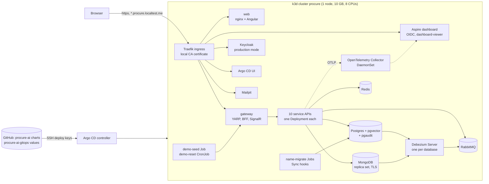

# Running procure-ai on Kubernetes

The whole system also runs on a local single-node Kubernetes cluster (k3d), deployed by Argo CD from the GitOps repo
[procure-ai-gitops](https://github.com/modefan/procure-ai-gitops). This is the same pattern as an AKS cluster managed with Argo CD:
Helm charts in this repo, environment values and the deployed revision in the GitOps repo, every change through git. The Aspire AppHost
stays the way to develop and debug; the cluster is how the system is deployed.

## The deployment at a glance



| Namespace | What runs there |
|---|---|
| `procure` | Platform (Postgres, MongoDB, Redis, RabbitMQ, Keycloak, Mailpit, eight Debezium Servers) and the apps (ten APIs, gateway, web, simulators, migration Jobs, demo data) |
| `observability` | OpenTelemetry Collector (DaemonSet: OTLP from the pods plus the pods' logs) and the standalone Aspire dashboard |
| `argocd` | Argo CD (one replica of each component; it manages itself after the bootstrap) |

The charts live in `deploy/charts/`:

| Chart | Contents |
|---|---|
| `procure-platform` | Our own small manifests (no Bitnami, no operators): StatefulSets for Postgres, MongoDB, RabbitMQ and the Debezium Servers, Deployments for Redis, Keycloak and Mailpit, network policies |
| `procure-app` | One app: Deployment, Service, ConfigMap, optional Ingress and the `<name>-migrate` Job (`--migrate`) |
| `procure-ai` | The umbrella: `procure-app` once per app (aliases) with the wiring the AppHost has, plus `demo-seed` and `demo-reset` |
| `procure-observability` | The Collector (upstream chart, pinned) and the Aspire dashboard |

Every container has requests and limits, runs as non-root with a read-only root filesystem, no privilege escalation and no
capabilities; .NET pods keep the AppHost's heap cap (`DOTNET_GCHeapHardLimit`), Java pods their `-Xmx`. Every Secret is referenced by
name and never optional, so a missing Secret key keeps the pod in `CreateContainerConfigError` instead of starting with a default.

## Hostnames and certificates

All hostnames are under `*.localtest.me`, which resolves to 127.0.0.1, so no hosts file is needed:

| Host | What |
|---|---|
| `https://procure.localtest.me` | The app (web and gateway on one origin) |
| `https://auth.procure.localtest.me` | Keycloak (issuer `https://auth.procure.localtest.me/realms/procure`) |
| `https://dashboard.procure.localtest.me` | Aspire dashboard (Keycloak sign-in; only users with the client role `dashboard-viewer`, the demo admin) |
| `https://argocd.procure.localtest.me` | Argo CD (user `admin`, password in Secret `argocd/argocd-initial-admin-secret`) |
| `https://mail.procure.localtest.me` | Mailpit (the demo's outgoing mail) |

TLS ends at Traefik with a wildcard certificate from a local CA (`bootstrap/new-local-ca.ps1` in the GitOps repo, kept in
`%USERPROFILE%\.procure-ai\local-ca\`). Pods trust the CA through the ConfigMap `procure-ca` (`SSL_CERT_DIR`), and CoreDNS answers
`auth.procure.localtest.me` with the Traefik service, so the APIs validate tokens against the same issuer URL the browser uses.

Browsers show a certificate warning until the CA is trusted. `bootstrap/trust-local-ca.ps1` adds it to the current Windows user's
certificate store (run it yourself; `-Remove` undoes it). On a PC with TLS-inspecting antivirus (ESET here) .NET and PowerShell clients
may see the antivirus' certificate instead of the cluster's; the test scripts therefore use curl with `--cacert` and the end-to-end tests
ignore certificate errors.

## Versions

| Part | Version |
|---|---|
| k3d / k3s (Kubernetes) | 5.9.0 / v1.35.5-k3s1 (pinned in the GitOps repo's `bootstrap/common.ps1`) |
| Argo CD | v3.5.7 (Helm chart argo-cd 10.11.7) |
| Ingress | Traefik, as bundled with k3s |
| Postgres | 17 with pgvector and pgaudit (`infra/postgres`) |
| MongoDB / Redis / RabbitMQ | 8.3 / 8.6 / 4.3 |
| Keycloak | 26.8.1, production mode (`start --optimized`, realm baked into `infra/keycloak`) |
| Debezium Server | 3.7.0.Final (`infra/debezium`) |
| OpenTelemetry Collector chart / Aspire dashboard | 0.178.2 / 13.6.2 |
| Helm (chart checks) | 3.20 with helm-unittest 1.2.1 and kubeconform 0.8.0 (CI job `charts`) |

## Bootstrap a cluster

Prerequisites: Docker Desktop, `k3d`, `kubectl`, `helm`, `gh` (signed in), the .NET SDK, and the AppHost user secrets (see "Run it
locally" in the README; the cluster's Secrets are made from them). Ports 80 and 443 must be free. **Never run the cluster and the Aspire
AppHost at the same time** (`k3d cluster stop procure` first): both need most of a 32 GB PC.

In the GitOps repo:

```powershell
./bootstrap/new-cluster.ps1      # k3d cluster `procure`: 1 server, 10 GB, 8 CPUs; CoreDNS rewrite; namespaces
./bootstrap/new-local-ca.ps1     # local CA, wildcard and MongoDB certificates, TLS Secrets, ConfigMap procure-ca
./bootstrap/new-secrets.ps1      # Kubernetes Secrets from the AppHost user secrets (+ GHCR pull secret from `gh auth token`)
./bootstrap/install-argocd.ps1   # deploy keys, Argo CD, repository Secrets, the root Application
```

From there Argo CD alone brings everything up in waves (Argo CD itself, then platform and observability, then the apps); on a fresh
cluster that takes about 10 to 15 minutes, pods may restart while their dependencies start. `tests/Test-FreshCluster.ps1` does all of
this from a deleted cluster and checks that it converges on its own. Every bootstrap script is safe to run again; after changing an
AppHost user secret, rerun `new-secrets.ps1` and restart the pods that use it.

Stop and start the cluster with `k3d cluster stop procure` / `k3d cluster start procure`; data is kept on the node's volumes. k3d stops
the node without draining it, so Postgres recovers from its WAL at the next start (safe: committed data is in the WAL) and a Debezium
replication slot may fall back to its last checkpoint, which only means a few changes are decoded again; Audit stores each change once.
`tests/Test-RestartKeepsData.ps1` checks that nothing is lost or doubled.

## How a push deploys

```text
push to procure-ai main
  -> CI (build, chart checks, client drift)
  -> publish.yml: images ghcr.io/modefan/procure-ai-<name>:<commit SHA> (platform images only when infra/<name> changed, tagged with
     its tree hash), then a commit "Deploy procure-ai <sha7>" to procure-ai-gitops envs/local/release.yaml
  -> Argo CD sees the new commit (polls every 2 to 3 minutes)
  -> root Application renders the Applications at the new appRevision
  -> wave -1: every <name>-migrate Job (Argo CD Sync hook) runs the service's --migrate with the new image
  -> wave  0: the Deployments roll to the new image, one pod at a time (maxSurge 0: the node has no room for surge pods)
  -> PostSync: demo-seed tops up the demo data
```

A failing migration stops the sync before wave 0, so the old pods keep serving; Argo CD retries the sync and the root Application
reports the app as not Healthy. Roll back by setting an older `appRevision` (and `platformImageTags`) in `envs/local/release.yaml`.
Both behaviours are checked on the cluster by `tests/Test-Upgrade.ps1` in the GitOps repo.

## Tests on the cluster

All in the GitOps repo's `tests/` unless noted. They need the cluster running and converged.

| Check | What it proves |
|---|---|
| `Test-FreshCluster.ps1` | From a deleted cluster, the bootstrap plus Argo CD converge on their own within 15 minutes, nothing crash-loops, then the smoke checks pass (`-WatchOnly`: only watch the running cluster) |
| `Test-Smoke.ps1` | Gateway and Keycloak through Traefik, demo login and BFF cookie, seeded data with the admin key, the dashboard's sign-in (only `dashboard-viewer` gets in) and its API being off |
| `Test-Upgrade.ps1` | A new revision reruns every migration Job before the pods change; a revision whose Requests migration fails keeps the old pods serving (throwaway branches, restored afterwards) |
| `Test-RestartKeepsData.ps1` | `k3d cluster stop/start` and deleted Postgres and MongoDB pods keep every row, document and Debezium position; a new change still reaches the data change log within 30 s |
| End-to-end tests (this repo) | The browser suite against `https://procure.localtest.me` (below) |

The end-to-end tests run against the cluster instead of an AppHost when `PROCUREAI_E2E_GATEWAY_URL` is set. Reset the demo data first
(the scan test needs the seeded PO-1001 without an invoice, and earlier runs leave their requests behind):

```powershell
kubectl --context k3d-procure -n procure create job "e2e-reset-$(Get-Date -Format HHmmss)" --from=cronjob/demo-reset
# wait until it completes (about a minute), then:
$env:PROCUREAI_E2E_GATEWAY_URL = 'https://procure.localtest.me'
$env:PROCUREAI_E2E_KEYCLOAK_URL = 'https://auth.procure.localtest.me'
dotnet run --project tests/ProcureAi.EndToEndTests -- -trait- "Target=AppHost"
```

Two tests carry `[Trait("Target", "AppHost")]` and only run against the AppHost: `Restarting_notifications_shows_reconnecting_then_live`
(it stops and starts a resource with the AppHost's commands; on the cluster Argo CD's self-heal would undo a scale to zero) and
`Stop_keeps_partial_answer` (it needs the slow Fake model stream only the test AppHost configures). The other way round,
`Live_connection_is_a_websocket_through_the_gateway` only runs against a deployment: under the AppHost the browser's hub connection
currently falls back to long polling (live updates still work), behind Traefik it is a real WebSocket.

## Measured memory

Measured 2026-11-05 on the 10 GB node with everything deployed (plan 07 complete, observability on): `docker stats` of the k3d node and
the sum of `kubectl top pods -A`.

| State | Node (docker stats) | Sum of pod working sets | Windows free (32 GB PC, Docker Desktop running) |
|---|---|---|---|
| Idle, after a demo reset | 8.14 GiB of 10 | 6.4 GiB | 8.7 GB |
| After the end-to-end suite (full procurement flow, chaos, AI screens) | 8.85 GiB of 10 | 6.8 GiB | 7.4 GB |

The largest pods: Keycloak about 0.55 GiB, Postgres about 0.37 GiB, each Debezium Server about 0.3 GiB (eight of them, 2.5 GiB together),
MongoDB about 0.32 GiB, each service API 0.12 to 0.26 GiB (Wolverine's pre-generated code, `docs/generated-code.md`), Argo CD about
0.4 GiB in all. The node's figure includes the kubelet, containerd and the page cache. The kubelet keeps 1 GiB for k3s itself and
evicts pods when less than 1 GiB is free (GitOps repo `bootstrap/common.ps1`), so a memory-hungry pod loses pods rather than starving the
API server.

## Troubleshooting

- **A pod stays in `CreateContainerConfigError`.** A Secret or one of its keys is missing: rerun `bootstrap/new-secrets.ps1` (it creates
  every Secret from the AppHost user secrets) and check `kubectl -n procure describe pod <pod>`.
- **Keycloak changes in `infra/keycloak/procure-realm.json` do not show on an existing cluster.** Keycloak imports the realm only once,
  into an empty database (`--import-realm` skips a realm that exists). A fresh cluster (`Test-FreshCluster.ps1`) gets the new realm; an
  existing one needs the change made by hand, e.g. with `kcadm.sh` in the Keycloak pod (credentials from the pod's own environment):

  ```powershell
  kubectl --context k3d-procure -n procure exec deploy/keycloak -- sh -c '/opt/keycloak/bin/kcadm.sh config credentials --server http://localhost:8080 --realm master --user "$KC_BOOTSTRAP_ADMIN_USERNAME" --password "$KC_BOOTSTRAP_ADMIN_PASSWORD" --config /tmp/kcadm.config && /opt/keycloak/bin/kcadm.sh get clients -r procure -q clientId=aspire-dashboard --fields id,redirectUris,optionalClientScopes --config /tmp/kcadm.config'
  ```

  Clusters made before plan 07 Task 7 need this for the dashboard client `aspire-dashboard`: redirect URI
  `https://dashboard.procure.localtest.me/` and the client scope `profile` as an optional scope (the dashboard asks for `openid profile`).
- **The dashboard says the sign-in failed, or shows 404 after signing in.** Only users with the `aspire-dashboard` client role
  `dashboard-viewer` get in (the demo admin); everyone else ends on a 404. A Keycloak error page about the redirect URI or scope means the
  realm patch above is missing.
- **The browser warns about the certificate.** Expected until the local CA is trusted (`bootstrap/trust-local-ca.ps1`).
- **Leftover Jobs after removing the app.** The `<name>-migrate` and `demo-seed` Jobs are Helm and Argo CD hooks, not release resources:
  `helm uninstall` leaves them behind, and so may deleting the Argo CD Application (the StatefulSets' volumes stay in any case). Remove
  them with `kubectl -n procure delete jobs -l app.kubernetes.io/part-of=procure-ai`.
- **demo-reset ran at an odd time.** It runs at 02:00 Africa/Johannesburg. A run missed while the cluster was stopped is skipped
  (`startingDeadlineSeconds: 600`), not started when the cluster starts again.
- **The PC gets slow.** Watch Windows' free memory; stop the cluster (`k3d cluster stop procure`) and run `wsl --shutdown` to give Docker
  Desktop's memory back to Windows.
- **A sync is stuck after a failed migration.** Fix the migration and deploy a new revision, or roll `appRevision` back. Argo CD retries a
  failed sync up to ten times with backoff; the Argo CD UI shows the failing hook and its log.
